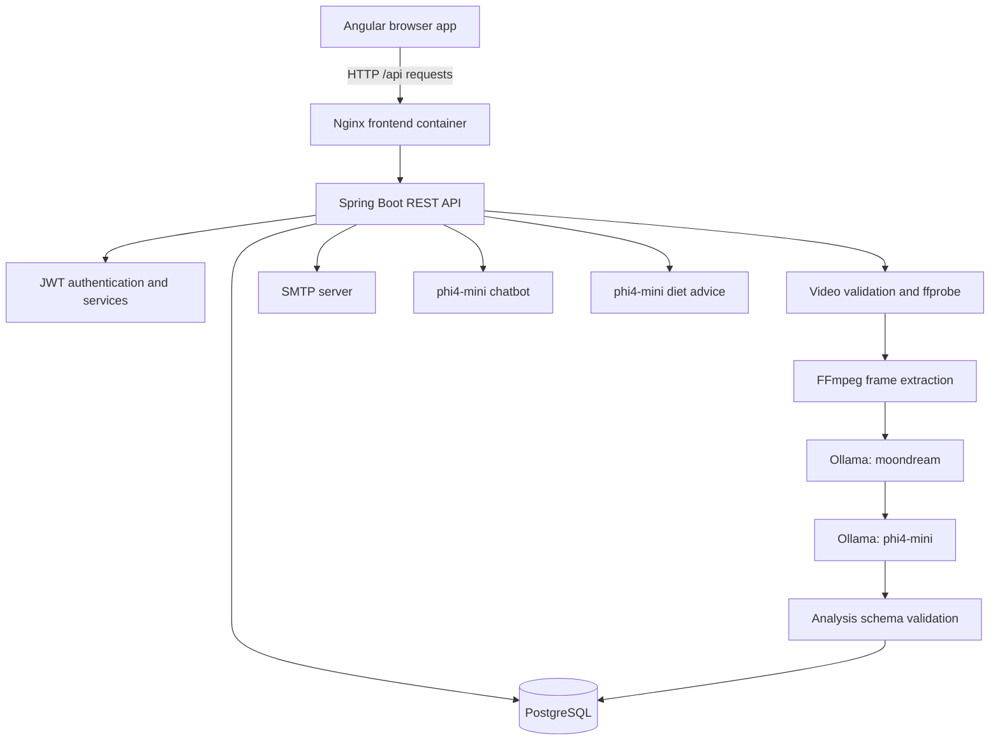

# SportIQ Knowledge Base

> Practical source of truth for developers, contributors, and AI coding assistants working on SportIQ. This describes the code currently in the repository, as distinct from planned features in the design documents.
>
> **Last reviewed:** 13 October 2026  
> **Repository:** https://github.com/Sandy11-9/SportIQ  
> **Default branch:** `main`

## 1. Project overview

SportIQ is a full-stack sports-coaching application. A signed-in user chooses a sport and skill, uploads a short video of an action, and receives a structured analysis containing scores and coaching feedback. The application also includes account verification by email OTP, a sports chatbot, BMI/calorie calculators with AI-generated diet advice, a profile view, and saved analysis history.

### Typical user journey

1. Register with an email address, password, and name.
2. Receive a one-time passcode (OTP) by email and verify the account.
3. Log in and receive a JWT.
4. Choose a sport and one of its supported skills.
5. Upload a short video.
6. The backend validates the video, extracts frames, sends them to the AI pipeline, validates the model result, and stores the analysis.
7. View the scores and coaching feedback, then retrieve the saved analysis from history.

AI feedback is advisory, not a professional coaching assessment or medical advice. A successful HTTP response does not by itself prove that the coaching result is accurate.

## 2. Technology stack

| Area | Current implementation |
|---|---|
| Frontend | Angular 19, TypeScript, SCSS, RxJS |
| Frontend container | Node.js 22 build stage, Nginx runtime |
| Backend | Java, Spring Boot, Spring MVC, Spring Security, Spring Data JPA |
| AI integration | Spring AI calling Ollama over HTTP |
| Vision model | `moondream` |
| Reasoning, chatbot, diet model | `phi4-mini` |
| Database | PostgreSQL 16 using the `pgvector/pgvector:pg16` image |
| Video tooling | FFmpeg and ffprobe |
| Backend tests | JUnit, Spring tests, Testcontainers |
| Frontend tests | Jasmine, Karma, Chrome Headless |
| Local orchestration | Docker Compose v2 |
| CI | GitHub Actions |

**Version note:** the backend Dockerfile builds/runs on Eclipse Temurin 21, while `backend/pom.xml` declares `java.version=17`. If changing the target JDK or bytecode level, update the POM and Dockerfiles together and rerun CI. The POM currently declares Spring Boot parent 4.0.7 and Spring AI BOM 2.0.0.

## 3. Repository map

```text
SportIQ/
├── backend/
│   ├── pom.xml
│   └── src/
│       ├── main/java/com/sportiq/backend/
│       │   ├── ai/          # AI clients, prompts, result schema and validation
│       │   ├── config/      # Security, catalog seeding and app configuration
│       │   ├── entity/      # JPA entities
│       │   ├── media/       # Upload validation, FFmpeg, frame/temp file handling
│       │   ├── repository/  # Spring Data repositories
│       │   ├── security/    # JWT and request authentication
│       │   ├── service/     # Auth, analysis, history, chatbot and diet services
│       │   └── web/         # REST controllers and DTOs
│       └── test/            # Unit, MVC, integration and end-to-end API tests
├── frontend/
│   ├── package.json
│   ├── angular.json
│   ├── nginx.conf
│   ├── public/demovideo.mp4
│   └── src/app/
│       ├── core/            # API/auth/token services, guards and interceptor
│       ├── auth/            # Login, register and OTP verification
│       ├── analyze/         # Video analysis UI
│       ├── history/         # Saved analyses
│       ├── profile/         # Current-user view
│       ├── chat/             # Sports assistant
│       ├── bmi/              # BMI calculator/advice
│       ├── calories/         # Calorie calculator/advice
│       └── rules/             # Recording guidance and demo clip
├── docker-compose.yml        # Local/full application stack
├── docker-compose.ci.yml     # Lightweight runtime smoke override
├── docker-compose.e2e.yml    # Mailpit SMTP test override
├── .env.example              # Safe local environment template
├── .github/workflows/
│   ├── runtime-verification.yml
│   └── full-e2e.yml
├── hld.md                    # High-level design
├── lld.md                    # Low-level design
├── README.md                 # Quick setup guide
└── KNOWLEDGE_BASE.md         # This document
```

## 4. Architecture and analysis data flow



The video-analysis pipeline is synchronous:

1. `POST /api/analyses` accepts multipart form data: `file`, `sportId`, `skillId`. JWT auth identifies the current user.
2. The backend resolves the sport/skill and checks that the skill belongs to the selected sport.
3. The upload is checked for emptiness, size, allowed content type (when supplied), and duration with ffprobe.
4. FFmpeg extracts JPEG frames to a per-upload temporary directory. The configured default is 1.5 frames/second; the implementation caps the frame count using a rounded target based on duration.
5. Each image is sent to `moondream` to describe the observed action.
6. Ordered observations and a skill-specific prompt are sent to `phi4-mini` for a structured response.
7. `AnalysisValidator` checks that scores exist, category names are nonblank and unique, scores are in the 0–100 range, and feedback lists are non-null. It trims feedback strings and removes blank entries.
8. The analysis session and scores are persisted; the API returns a response containing the scores and coaching points.
9. The request cleanup path removes temporary video/frame artifacts. The scheduled cleanup service acts as an additional safety net.

The AI result includes score entries with category/score pairs and the feedback lists `goodPoints`, `badPoints`, and `improvements`.

## 5. Implemented sport/skill catalog

The current `backend/src/main/java/com/sportiq/backend/config/DataSeeder.java` creates two sports and **five skills**:

| Sport ID | Sport | Skill ID | Skill | Prompt key |
|---:|---|---:|---|---|
| 1 | Cricket | 1 | Bowling | `cricket_bowling` |
| 1 | Cricket | 2 | Batting | `cricket_batting` |
| 2 | Football | 3 | Shooting | `football_shooting` |
| 2 | Football | 4 | Passing | `football_passing` |
| 2 | Football | 5 | Dribbling | `football_dribbling` |

Prefer reading IDs/names from `GET /api/sports` and `GET /api/sports/{sportId}/skills` rather than hardcoding them in new clients.

**Design drift:** `hld.md` and `lld.md` describe a different, larger catalog. The runtime seed data and skill prompts are authoritative until code and design docs are reconciled.

## 6. REST API reference

In Docker Compose, the browser reaches the backend through Nginx at `http://localhost:4200/api`. The backend is also exposed directly at `http://localhost:8080` for local diagnosis.

| Method | Route | Purpose |
|---|---|---|
| POST | `/api/auth/register` | Register a pending account; sends an OTP email |
| POST | `/api/auth/verify-email` | Verify account using received OTP |
| POST | `/api/auth/resend-otp` | Request a replacement OTP, subject to configured cooldown |
| POST | `/api/auth/login` | Authenticate a verified user and return a JWT |
| GET | `/api/users/me` | Get the current user's profile |
| GET | `/api/sports` | List sports |
| GET | `/api/sports/{sportId}/skills` | List skills for a sport |
| POST | `/api/analyses` | Upload and analyze a video |
| GET | `/api/analyses?page=0&size=20` | List current user's analyses; optional `sportId` and `skillId` filters |
| GET | `/api/analyses/{id}` | Retrieve a saved analysis |
| POST | `/api/chat` | Ask the sports assistant; JSON body contains `message` |
| POST | `/api/diet-advice` | Request structured BMI/calorie diet advice |

The auth routes are public entry points. Other protected API routes require a valid bearer token.

### Example analysis upload

```bash
curl -X POST http://localhost:8080/api/analyses \
  -H "Authorization: Bearer $TOKEN" \
  -F "file=@sample.mp4;type=video/mp4" \
  -F "sportId=2" \
  -F "skillId=3"
```

A successful analysis creation returns `201 Created`. Since inference is local and synchronous, the request can take significantly longer than a conventional REST request.

## 7. Video input requirements

Current defaults in `backend/src/main/resources/application.yml`:

- Minimum duration: 5 seconds
- Maximum duration: 20 seconds
- Maximum size: 50 MiB
- Frame sampling rate: 1.5 frames/second
- Configured content types: `video/mp4`, `video/quicktime`, `video/x-m4v`, `video/webm`, `video/x-matroska`

The recording guidance recommends a single clearly visible player/action, no distracting text/watermark, and a clip focused on the action. Upload only videos you have permission to use.

**Source comment mismatch:** `VideoValidationService` still has a comment mentioning a 5–8 second duration, while the configured runtime defaults/UI rules are 5–20 seconds. Follow the runtime configuration for current behavior and update the stale comment during future maintenance.

## 8. Environment and secrets

Create a local `.env` at the repository root from `.env.example`. Do not commit `.env`.

| Variable | Purpose |
|---|---|
| `SPORTIQ_JWT_SECRET` | Required JWT signing secret; generate a unique, random value |
| `SPRING_MAIL_HOST` | SMTP hostname; default is Gmail SMTP |
| `SPRING_MAIL_PORT` | SMTP port; default 587 |
| `SPRING_MAIL_USERNAME` | SMTP login/user |
| `SPRING_MAIL_PASSWORD` | SMTP provider/app password |
| `SPRING_MAIL_FROM` | Sender address for verification emails |

Use a provider app password or dedicated SMTP credential, not a normal account password. Never paste secrets into chat, commit them to source, or write them into the knowledge base.

A credential resembling a real SMTP app password was previously present in repository history. Removing it from the newest file does not revoke it or erase old history. **Revoke/rotate the exposed credential with the provider and never reuse it.**

The database credentials in Compose are demo/local defaults. Before a shared or production deployment, use managed secrets, unique database credentials, restricted network exposure, and a reviewed security configuration.

## 9. Run locally with Docker Compose

Prerequisites: Docker Desktop with Compose v2, adequate free disk/RAM for the Ollama models, and an SMTP account if you want to test real email delivery.

From PowerShell at the repository root:

```powershell
Copy-Item .env.example .env
# Edit .env: set a strong SPORTIQ_JWT_SECRET and real SMTP values if testing email.
docker compose up --build -d
docker compose ps -a
docker compose logs -f ollama-setup backend frontend
```

The first startup downloads the Ollama image and models and may take several minutes. Wait for the setup service to complete successfully and log `MODELS_READY`, then check that backend and frontend containers are running.

- Frontend: http://localhost:4200
- Backend API: http://localhost:8080
- Ollama API inside Compose: `http://ollama:11434`

Stop while retaining named model/database volumes: `docker compose down`. To delete the volumes and their persisted contents as well, use `docker compose down -v`.

### Local test commands

```powershell
# Frontend
cd frontend
npm ci
npm run build
npm test -- --watch=false --browsers=ChromeHeadlessCI

# Backend: Java/Maven, FFmpeg and Docker are needed for the full test suite
cd ../backend
mvn test
```

Run frontend commands from `frontend` and backend commands from `backend`.

## 10. Verification status

### Normal automated verification

The [runtime verification workflow](.github/workflows/runtime-verification.yml) runs on pushes and pull requests to `main`. It:

1. Runs backend Maven tests with FFmpeg installed.
2. Builds the production Angular frontend and runs the Angular unit tests.
3. Starts a lightweight Docker Compose stack (model pulls skipped) and checks frontend HTTP response plus direct and Nginx-proxied protected API responses.

The [successful run 38370893483](https://github.com/Sandy11-9/SportIQ/actions/runs/38370893483) passed the backend tests, frontend build/unit tests, and lightweight Compose smoke test. [Run 38374423654](https://github.com/Sandy11-9/SportIQ/actions/runs/38374423654) also passed these normal checks on the verification branch.

These checks cover build, tests, container startup, and routing. They do **not** prove real model inference or delivery through an external email provider.

### Full real-model E2E

The [full E2E workflow](.github/workflows/full-e2e.yml) downloads the real `moondream` and `phi4-mini` models, starts the app with Mailpit as a disposable SMTP test inbox, attempts registration, reads the OTP from the test inbox, verifies the user, logs in, uploads the demo clip without mocking AI, and checks that the analysis can be retrieved from history.

**Current E2E status (13 October 2026): not passed.** The workflow successfully pulled the Ollama models and started the application containers, but registration returned HTTP 503 because the verification email could not be sent to the test SMTP inbox. As a result, OTP reception/verification, real video inference, and analysis history were not reached in that E2E attempt. The optional external SMTP probe has not run because external SMTP secrets and a recipient inbox were not supplied.

Treat real AI video analysis and external email delivery as **not yet verified** until a newer full E2E run passes those steps. The full run is deliberately resource-heavy because it downloads and runs local models.

For an external SMTP probe, the workflow expects GitHub Actions secrets named `SPORTIQ_E2E_SMTP_HOST`, `SPORTIQ_E2E_SMTP_PORT`, `SPORTIQ_E2E_SMTP_USERNAME`, `SPORTIQ_E2E_SMTP_PASSWORD`, and `SPORTIQ_E2E_SMTP_FROM`, plus a recipient inbox supplied at workflow dispatch. SMTP server acceptance is not the same as proof of inbox delivery; confirm the message actually arrives.

## 11. Known gaps and engineering cautions

1. **SMTP E2E currently fails:** the full workflow receives HTTP 503 during registration because Mailpit OTP delivery fails. Inspect the underlying mail exception and SMTP settings, particularly authentication/TLS settings for the unauthenticated test server; rerun the full workflow after the fix.
2. **Real AI inference is not yet verified:** the models downloaded in the failed E2E run, but the workflow stopped before the upload/analysis stage. Run a real compatible clip after fixing email delivery.
3. **Catalog/docs mismatch:** design documents describe more skills and some different endpoint paths than the current implementation.
4. **Temporary directory cleanup risk:** `FileCleanupService` currently selects every directory below the temporary directory regardless of age, while file entries are age-filtered. Review this before concurrent/production use: a scheduled sweep could interfere with in-progress frame directories.
5. **Security hardening:** rotate historically exposed SMTP credentials; use a strong per-environment JWT secret; replace demo DB credentials before shared deployments; review OTP attempt throttling/rate limiting.
6. **Long synchronous AI calls:** analysis depends on local model availability and can be slow. Review timeouts, cancellation behavior, resource limits, monitoring, and user-facing retry/error messages before production deployment.
7. **Production deployment is separate:** CI builds and smoke-tests disposable containers; it does not set up a public production host, TLS, backups, persistent operational monitoring, or production secrets.

## 12. Suggested next steps

1. Fix the Mailpit SMTP auth/TLS mismatch and rerun `full-e2e.yml`.
2. Verify OTP receipt, account verification, JWT login, a genuine video analysis, and retrieval of that saved analysis.
3. Run the optional external SMTP probe with a rotated credential stored in GitHub Actions secrets, then confirm delivery in an inbox you control.
4. Fix temporary directory cleanup to protect in-flight processing directories.
5. Reconcile `hld.md` and `lld.md` with the current routes, limits, and five-skill catalog.
6. Review rate limiting, secrets, database credentials, model resource usage, and production deployment controls before deploying.

## 13. Guidance for future AI coding assistants

- Read this knowledge base and the relevant current controller/service/test files before making a change.
- Treat the source and current test results as authoritative; do not assume that a feature listed in a design doc exists.
- Do not print, request, or commit secrets. Use environment variables or a secure secret store.
- For backend changes, add or update JUnit tests and run `mvn test`.
- For frontend changes, update relevant specs and run `npm run build` plus `npm test -- --watch=false --browsers=ChromeHeadlessCI`.
- For cross-stack changes, run the normal GitHub Actions workflow. Run the full real-model E2E when its resource cost is justified.
- Update this file whenever routes, configuration, catalog, architecture, workflows, or verification status changes.
