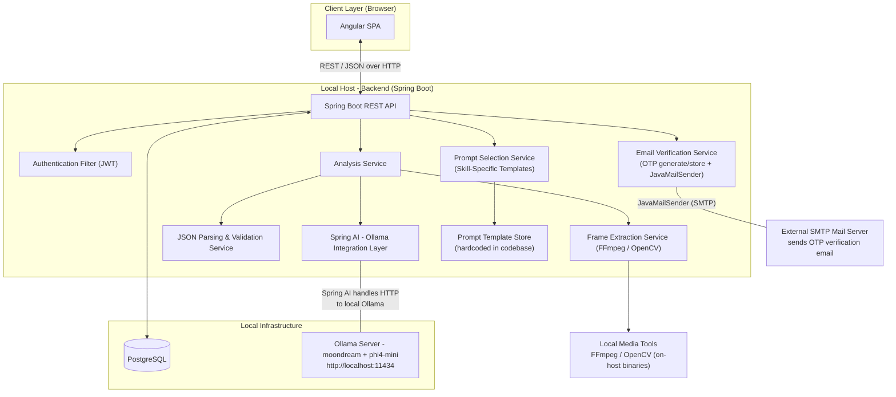
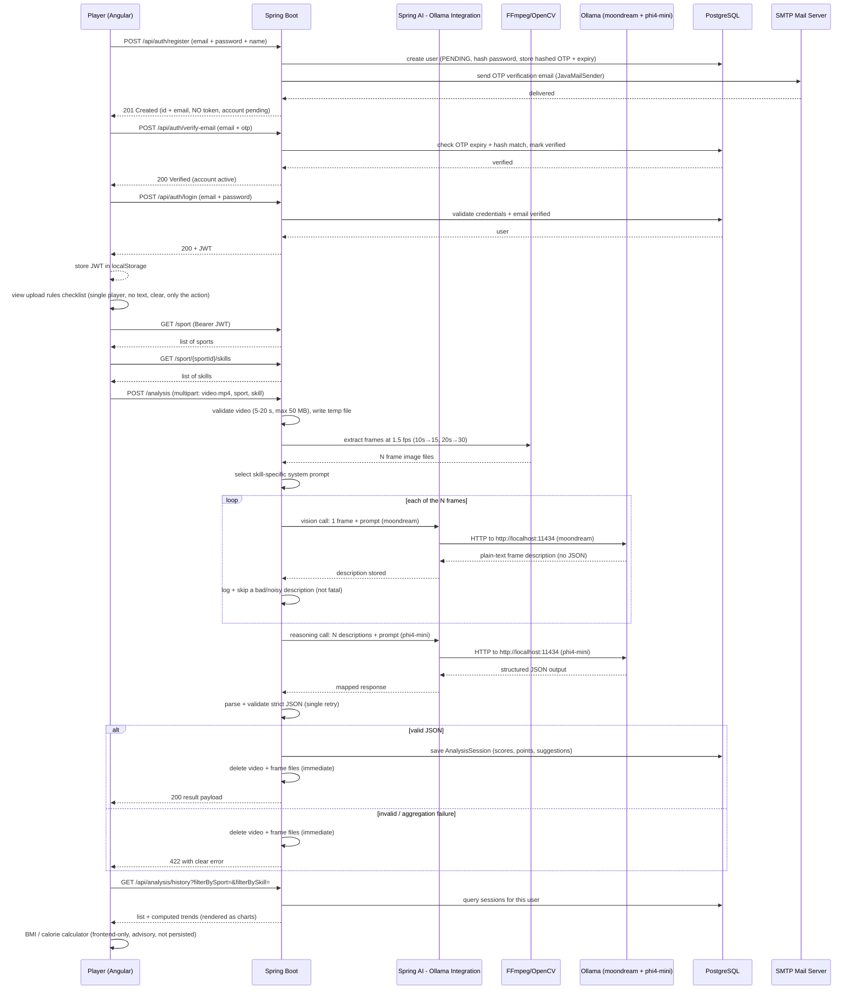
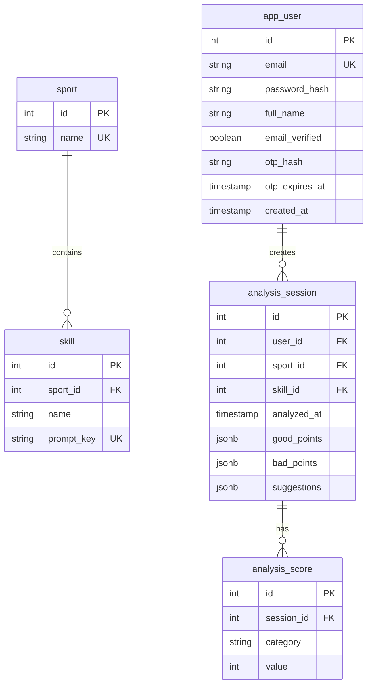

# SportIQ — AI-Based Sports Performance Analysis App

**High-Level Design (HLD) Document**

| Field | Value |
| --- | --- |
| **Project Name** | SportIQ |
| **Project Type** | College Final-Year Mega Project |
| **Document Version** | 1.1 |
| **Status** | Implementation-Ready Blueprint |
| **Audience** | Development Team, Faculty Guide, External Examiners |

---

## Table of Contents

1. [Introduction & Project Scope](#1-introduction--project-scope)
2. [System Architecture](#2-system-architecture)
3. [Module Breakdown](#3-module-breakdown)
4. [High-Level Data Flow](#4-high-level-data-flow)
5. [Technology Stack Justification](#5-technology-stack-justification)
6. [High-Level Entity Overview](#6-high-level-entity-overview)
7. [Assumptions and Constraints](#7-assumptions-and-constraints)
8. [Future Enhancements](#8-future-enhancements)

---

## 1. Introduction & Project Scope

### 1.1 Introduction

**SportIQ** is a single-actor (Player-only) web application with a rich, sports-themed UI. It uses a locally running vision-language AI model to analyze a short sports performance video and return a structured, text-based performance analysis, alongside helper tools such as BMI and calorie calculators.

New accounts are activated only after **email (OTP) verification** — the backend generates a one-time code, sends it to the registered address via Spring Boot's `JavaMailSender`, and the account becomes active only after the code is confirmed. This keeps dummy/fake emails out of the system.

The analysis workflow is as follows: a player uploads a 5–20 second video of themselves performing a specific sports skill. A **UI rules checklist** (single player only, no on-screen text, clear footage, only the sport action — not warm-up/run-up) is shown before upload as guidance; the backend enforces the technical limits (MP4, 5–20 s, ≤ 50 MB) while the rule checklist stays advisory. The backend extracts key frames at a **dynamic rate of 1.5 frames per second of video** (10 s → 15 frames, 20 s → 30 frames) and runs a **two-stage local AI pipeline**: a vision model describes each frame in plain text, then a reasoning model aggregates those descriptions (together with the skill-specific prompt) into a strictly structured JSON analysis containing category-wise scores, strengths (good points), weaknesses (bad points), and improvement suggestions. The raw video and extracted frames are **immediately deleted** after analysis — the only artifact persisted is the text-based analysis result, stored against the player's history and grouped by sport and skill.

### 1.2 Problem Statement

Amateur and semi-amateur players often lack access to coach-led feedback the moment they practise. Existing solutions rely on cloud-based AI services, paid third-party APIs, and data-hosting platforms, none of which are feasible in a constrained, self-hosted college demo. SportIQ addresses this by delivering automated, objective, skill-specific feedback entirely on local infrastructure.

### 1.3 Objectives

- Provide a simple registration/login flow with JWT-based authentication for a Player actor.
- Verify every new account via an **email OTP** sent by the backend (`JavaMailSender`); accounts remain inactive until the code is confirmed.
- Enable sport and skill selection (Cricket / Football with their respective skills).
- Accept short sports skill videos (5–20 seconds).
- Show a **video upload rules checklist** (single player, no text, clear footage, only the sport action) in the UI before upload.
- Automatically extract key frames at **1.5 frames per second** of video (dynamic count, not fixed).
- Run a two-stage local AI pipeline: **moondream** (vision) describes each extracted frame in plain text, then **phi4-mini** (reasoning) aggregates the descriptions into the structured result.
- Parse and validate strict JSON AI output.
- Persist only the textual analysis result linked to the user, sport, skill, and timestamp.
- Delete the raw video and frames immediately after analysis.
- Present a filterable performance history dashboard with score trends rendered as **charts/graphs**.
- Provide **BMI and calorie calculators** (input-driven, advisory, not persisted).
- Complete the full round trip well within a **10-minute** budget (covers up to 30 frames).

### 1.4 In-Scope Features

1. User Registration and Login (JWT) with **email OTP verification**
2. Player Profile Management
3. Sport Selection (Cricket, Football)
4. Skill Selection:
   - **Cricket:** Bowling, Batting, Fielding
   - **Football:** Power Shot, Header, Placed Shot, Bicycle Kick, Goalkeeping
5. Upload Sports Video (5–20 s, e.g., mp4)
6. **Video upload rules checklist** shown in the UI (single player, no text, clear footage, only the sport action) — advisory, not enforced by the model
7. Key Frame Extraction (**1.5 frames per second** of video, e.g., 15 for a 10 s clip, 30 for a 20 s clip)
8. Skill-specific System Prompt selection (hardcoded prompt templates in the backend, one per sport+skill combination)
9. Per-frame Vision Analysis via Ollama (moondream) — one plain-text description per extracted frame
10. Reasoning Aggregation via Ollama (phi4-mini) — merges the frame descriptions into strict JSON (scores, good/bad points, suggestions) with parsing/validation
11. Immediate deletion of video + frames after analysis
12. Persist analysis result (PostgreSQL)
13. Performance History Dashboard (filterable, score trends rendered as **charts/graphs**, no video playback)
14. **BMI calculator** and **calorie calculator** (input-driven, advisory, not stored)
15. Rich, sports-themed UI with imagery and animations

### 1.5 Out-of-Scope

- Audio analysis, video playback on dashboard
- Live/streaming analysis
- Coach/Admin roles and multi-actor systems
- **Model-based enforcement** of the upload rules checklist (single player / no text / clarity / only the sport action) — the checklist is UI guidance only; no AI content-checking is performed
- Cloud storage, cloud AI, CDNs, payment, notifications (except SMTP email used only to deliver the registration OTP)
- SMS/WhatsApp OTP delivery — email OTP only
- Persisting BMI/calorie calculator inputs or results — the calculators are advisory and stateless
- Wearable/device integrations (see Future Enhancements)

---

## 2. System Architecture

### 2.1 Architectural Style

A **monolithic, on-premise, layered architecture**:
- **Presentation Layer:** Angular SPA (browser) — rich sports-themed UI with charts and calculators
- **Application Layer:** Spring Boot REST API (single deployable JAR), including a JavaMailSender-based email service for OTP delivery
- **Model Layer:** PostgreSQL database
- **External Local Tools:** Ollama (moondream for vision, phi4-mini for reasoning) via local REST API, FFmpeg/OpenCV for frame extraction — invoked from Spring Boot (no separate microservice)
- **External SMTP:** a mail server (e.g., Gmail SMTP) used only to deliver the one-time registration code; credentials live in `application.yml`

Everything runs on the developer's/local demo machine, with no dependency on the internet except for a locally available Ollama server.

### 2.2 Architecture Diagram (Mermaid)

### 2.3 Component Responsibilities

| Component | Responsibility |
| --- | --- |
| **Angular Client** | Rich sports-themed login/register with **OTP email verification**, profile, sport & skill selection, **video upload rules checklist**, video upload, BMI & calorie calculators, shows analysis result with charts, dashboard history & trends. |
| **Spring Boot Backend** | Exposes REST endpoints, enforces JWT security, orchestrates **OTP generation/emailing**, frame extraction, prompt selection, LLM calls, JSON parsing, persistence, and the media cleanup lifecycle. |
| **Email Verification Service (JavaMailSender)** | On registration, generates a short-lived OTP, hashes and stores it against the pending user, and emails it via Spring Boot's `JavaMailSender`. Confirms the code on the verify endpoint and activates the account. |
| **Spring AI - Ollama Integration Layer** | Spring-native abstraction over the local Ollama server. Configures the connection to `http://localhost:11434` and drives two `ChatClient` beans — `visionChatClient` (moondream) for the per-frame multimodal stage and `reasoningChatClient` (phi4-mini) for the text aggregation stage — mapping requests/responses via `ChatModel` and replacing any raw HTTP client code. |
| **FFmpeg / OpenCV** | Extracts frames at a **rate of 1.5 frames per second** of the uploaded video. |
| **Ollama** | Hosts moondream (vision) and phi4-mini (reasoning) models locally; serves a REST API that Spring AI talks to. |
| **PostgreSQL** | Stores users (with verification status and OTP fields), sports, skills, and analysis sessions/results. |
| **External SMTP Server** | Delivers the registration OTP email only. Credentials configured via `spring.mail.*` placeholders in `application.yml`. |

> **Notes:** FFmpeg/OpenCV runs as a *local on-host binary/library* invoked by Spring Boot. It is not a separate service. Spring AI only ever talks to the local Ollama instance. The only external process the backend contacts is the local Ollama instance and the SMTP server (for OTP email delivery only).

---

## 3. Module Breakdown

### 3.1 Authentication Module (Auth)

- **Register (`POST /api/auth/register`):** email + password → BCrypt-hash the password → create the account in a **PENDING (unverified)** state → generate a 6-digit OTP → hash & store it with a short expiry → email it via `JavaMailSender` → return a success confirmation (e.g., `201 Created` with user id/email). Registration does **NOT** auto-issue a JWT and the account cannot log in until verified.
- **Verify email (`POST /api/auth/verify-email`):** the user submits `email + otp` → backend checks expiry and matches the stored hash → on success marks the account **verified**, clears the OTP → the user may now log in.
- **Resend OTP (`POST /api/auth/resend-otp`):** regenerates and re-emails the OTP for a PENDING account (e.g., code expired or never received).
- **Login (`POST /api/auth/login`):** requires a **verified** account. Unverified accounts are rejected (`403`) with a "verify your email first" message. On success the user receives a JWT (access token).
- **Token flow:** Angular stores the JWT in the browser's **localStorage** and sends it as `Authorization: Bearer <token>` on every protected request.
- **Security:** Spring Security with a stateless JWT filter; `POST /api/auth/register`, `POST /api/auth/verify-email`, and `POST /api/auth/resend-otp` are public; all other `/api/**` endpoints are protected.
- **Security note (acknowledged trade-off):** storing the JWT in localStorage is a simplified approach chosen for this local college project demo. It is more exposed to XSS than httpOnly cookies; however, given the fully local, offline, non-production scope of the app, this is acceptable.
- **OTP hygiene:** OTPs are stored **hashed** (never plaintext), expire after 10 minutes, are single-use, and the resend/verify endpoints are rate-limited to prevent brute force and mail spam.
- **Profile:** view/update player profile (name, email, optional avatar). Email uniqueness enforced at the DB and service level.

### 3.2 Sport & Skill Selection Module

- Serves the catalog of **Sports** and **Skills** via REST.
- Restricts the list of skills based on the selected sport (e.g., selecting *Cricket* surfaces only Cricket skills).
- The sport/skill catalog is seeded once at application startup.

### 3.3 Video Upload & Frame Extraction Module

- **Upload rules checklist (UI):** before uploading, the frontend shows a checklist of recommended rules — *single player only*, *no on-screen text/watermarks*, *clear, stable footage*, and *only the sport action itself* (e.g., for batting, just the shot — not the run-up, warm-up, or celebrations before/after). This is **advisory guidance only**; the backend does not model-check these conditions.
- **Upload:** multipart REST endpoint accepts a video file (`mp4`, 5–20 s). Server validates file type and MIME.
- **Validation rules (fixed limits):** maximum video file size of **50 MB**, and a video duration between **5–20 seconds**. Files failing either limit are rejected before any AI work. Invalid files are returned a clear error and never processed.
- **Frame Extraction:** invoke FFmpeg (or OpenCV) to extract key frames at a **dynamic rate of 1.5 frames per second** of the video (`frameCount = ceil(durationSeconds × 1.5)`). A 10 s clip yields ~15 frames; a 20 s clip yields ~30 frames. More frames give the vision model more data and hence more accurate analysis. Frames are written to a temporary directory.
- **Temporary directory handling:** frame filenames embed the analysis/session id to avoid collisions under concurrent use.

### 3.4 AI Analysis Module

- **Prompt Selection:** pick the correct **skill-specific system prompt template** from the hardcoded library based on the selected sport + skill combination. Each sport+skill pair has its own defined template.
- **Two-stage Spring AI Ollama Integration:** all interaction with the local Ollama server is handled by **Spring AI** (via its Ollama starter), rather than raw manual REST calls. **Stage 1 (vision):** for each of the extracted frames (1.5 per second of video, up to ~30), Spring AI sends a single frame (base64-encoded) together with the skill-specific prompt to the `moondream` model using a `ChatModel` / multimodal (image + text) message API and receives a **plain-text description** of that frame — no structured output is attempted at this stage (moondream is unreliable for that). **Stage 2 (reasoning):** the collected frame descriptions are sent, together with the skill-specific system prompt, to the `phi4-mini` model in an ordinary text `ChatModel` call which requests the strict JSON output.
- **Parsing & Validation:** parse the reasoning model's aggregated output and validate its structure (scored categories, good/bad points, suggestions). If validation fails, retry the aggregation call once; on repeated failure return a clear, user-facing error.

### 3.5 Result & Feedback Module

- Renders the analysis result: category-wise scores, good points, bad points, improvement suggestions.
- Displays the per-category scores as a **bar/radar chart** (Chart.js) alongside the textual feedback.
- Confirms the result is stored, then triggers the media cleanup.

### 3.6 History / Dashboard Module

- Returns paginated history of the player's analyses, filterable by sport and skill.
- Computes per-category average scores and time-series trends for **chart** rendering (line/area charts).
- Read-only: no video playback, only text and scores.

### 3.7 Helper Tools (BMI & Calorie Calculators)

- **BMI calculator:** user enters weight (kg) and height (cm) → BMI = weight ÷ height(m)² → classified (underweight / normal / overweight / obese) with advisory note.
- **Calorie calculator:** user enters age, gender, weight, height, activity level and a goal → computes BMR (Mifflin-St Jeor) → TDEE = BMR × activity factor → daily calorie target for losing / maintaining / gaining weight.
- Frontend-only calculations; **no inputs or results are persisted**. These are advisory health tools for the demo.

### 3.8 (Shared) Analysis Lifecycle / Cleanup

- Tracks the temporary media files and guarantees deletion of the video and frames once analysis completes — on both success and failure paths.

---

## 4. High-Level Data Flow

### 4.1 Request Pipeline

Below is the end-to-end data flow for a single analysis.

### 4.2 Step-by-Step User Journey

1. **Register** → `POST /api/auth/register` creates the account in a **pending** state, hashes the password, stores a hashed OTP with a 10-minute expiry, and emails the OTP (no token issued).
2. **Verify Email** → `POST /api/auth/verify-email` with the emailed OTP activates the account; resend available via `POST /api/auth/resend-otp`.
3. **Login** → `POST /api/auth/login` (verified accounts only) returns a JWT, which is stored in localStorage.
4. **Select Sport** → system filters available skills.
5. **Select Skill** → user picks a specific drill.
6. **Review Rules** → user sees the upload rules checklist (single player, no text, clear footage, only the sport action).
7. **Upload Video** → 5–20 s MP4, max 50 MB.
8. **Extract Frames** → FFmpeg/OpenCV output **1.5 frames per second** (10 s → 15, 20 s → 30).
9. **Build Prompt** → matching skill-specific system template.
10. **Vision Stage** → Spring AI sends each frame individually to moondream and collects the plain-text descriptions (a bad/noisy description is logged and skipped).
11. **Reasoning Stage** → Spring AI sends the descriptions + prompt to phi4-mini, then parses/validates the strict JSON (single retry).
12. **Save Result** → persist to PostgreSQL.
13. **Delete Media** → remove video + frames (immediate).
14. **Show Result** → present feedback and structured scores to player, with charts.
15. **Dashboard** → history grouped/filterable, with score trends as charts.
16. **Helpers** → BMI and calorie calculators available from the UI (advisory, not persisted).

---

## 5. Technology Stack Justification

| Technology | Stage | Relevance / Why |
| --- | --- | --- |
| **Angular** | Frontend | Mature, opinionated TypeScript framework; strong componentization and straightforward chart integration (e.g., Chart.js), all usable fully offline. Ideal SPA for forms and dashboards. |
| **Spring Boot** | Backend | Enterprise-grade Java; robust REST and Spring Security, excellent for local development. Simplifies orchestration (file IO, Spring AI integration, DB, mail). Ships as a single deployable JAR that fits a demo machine. |
| **PostgreSQL** | Database | Relational, reliable, free, self-hosted. Fits structured data (users) and structured analysis JSON. Good for filters and trends. |
| **FFmpeg / OpenCV** | Frame extraction | Local, offline, fast frame extraction. Runs as on-host commands invoked from Spring Boot; no separate service required. |
| **Spring AI (Ollama starter)** | LLM integration | Spring AI's Ollama starter (`spring-ai-starter-model-ollama`) manages all interaction with the local Ollama server. It provides a clean, Spring-native abstraction over Ollama's API, simplifies multimodal (image + text) prompt construction, handles request/response mapping, and reduces boilerplate HTTP client code — while keeping everything fully local and offline (Spring AI only talks to the local Ollama instance, no cloud dependency). |
| **Spring Boot Mail (JavaMailSender)** | Email verification | `spring-boot-starter-mail` sends the one-time registration code (OTP). SMTP credentials are provided as placeholders in `application.yml` (filled with the demo account's real credentials). |
| **Ollama + moondream + phi4-mini** | AI/ML | Fully local two-model pipeline: moondream is a lightweight vision-capable model used for per-frame plain-text descriptions; phi4-mini is a small text LLM that aggregates the descriptions into the structured JSON result. No cloud dependency, safe for offline demos. |
| **Chart.js (ng2-charts)** | Charts | Lightweight, offline charting for score bars/radar on analysis results and line/area score trends on the dashboard. |
| **JWT (auth, built-in)** | Authentication | Stateless, no OAuth / external IdP; simple email+password + email-OTP verification model matches the constraints. |
| **OpenCode** | Dev tool | Code-generation assistant used to scaffold and maintain the codebase. |

All choices share a common trait: they are **free, self-hosted, and offline**, with **no paid third-party services** required.

---

## 6. High-Level Entity Overview

No `Video` entity exists, since videos are ephemeral. The persisted domain model is described below.

### 6.1 Notes on the model

- **app_user** — the single Player actor; identity for authentication and ownership of all sessions. Holds the email-verification state (`email_verified`) and the hashed OTP + expiry used during registration; OTP fields are cleared once verified.
- **sport** / **skill** — catalogs; a skill belongs to one sport and references a `prompt_key` that selects the correct system prompt template.
- **analysis_session** — the persisted result of one analysis; holds the free-text good points, bad points, and suggestions, plus the timestamp and sport/skill foreign keys. There is **no video/file column**.
- **analysis_score** — a per-category normalized score for a session. Because the scored categories vary per skill (form, power, accuracy, etc.), this flexible child table supports trends and filtering cleanly.

---

## 7. Assumptions and Constraints

### 7.1 Assumptions

- **Local Ollama server** must be installed, running, and serving the `moondream` (vision) and `phi4-mini` (reasoning) models on `http://localhost:11434` before any analysis can run. The backend reaches it through **Spring AI's Ollama integration**, not a raw HTTP client.
- **FFmpeg or OpenCV** is installed on the backend host and is executable from within the Spring Boot process (either on the system PATH or set via the `FFMPEG_BIN` environment variable).
- **SMTP credentials** for email verification are supplied via the `spring.mail.*` placeholders in `application.yml` (e.g., a Gmail app password). No mail server is bundled with the app.
- The host machine has sufficient CPU/RAM for moondream (vision) and phi4-mini (reasoning) inference on short clips — the round-trip budget of **10 minutes** comfortably covers up to 30 frame descriptions.
- Input video is a standard, decodable MP4 (H.264); duration and aspect fit the stated ranges.
- The reasoning model (`phi4-mini`) returns strict JSON for the aggregated result; the vision model (`moondream`) returns plain-text frame descriptions. The backend includes a fault-tolerant parser with a single retry path for the aggregation call.

### 7.2 Constraints (Hard Limits)

- **Video length:** 5–20 seconds (enforced at upload).
- **Maximum file size:** 50 MB per uploaded video (enforced at upload).
- **Frames:** extracted at **1.5 frames per second** of video (`ceil(duration × 1.5)`; e.g., 5 s → 8, 10 s → 15, 20 s → 30). No user-adjustable knob.
- **No media persistence:** the uploaded video and extracted frames are deleted immediately after analysis — nothing except the text result is ever stored.
- **Email verification is mandatory:** an account cannot log in until its email is verified via OTP.
- **Single actor:** Player only; no Coach/Admin roles.
- **No cloud / external services:** no cloud storage, no cloud AI, no CDN, no payment gateways, no push notifications, no third-party integrations — the only external processes contacted are the local Ollama instance (via Spring AI) and the SMTP server (for the registration OTP only).
- **Round-trip guarantee:** upload → frames → two-stage LLM pipeline → response must complete within a **10-minute** budget (up to 30 frames). Individual per-frame vision (moondream) calls each carry their own shorter hang-guard (~8–10 s) within that total budget.
- **Fixed tech stack:** Angular / Spring Boot / Spring AI / PostgreSQL / FFmpeg-OpenCV / Ollama (moondream + phi4-mini) / JavaMailSender; no additions.

### 7.3 Edge Conditions to Handle

- Non-video or too-long/too-short files are rejected at upload time.
- Registering with a **duplicate or invalid email** → `409` / `400` at registration; **dummy emails** are blocked in practice because the account stays inactive until the emailed OTP is confirmed.
- OTP **wrong, expired, or tampered** → clear error; user can request a resend.
- SMTP send failure (bad credentials / network) → registration still recorded but the user is told the email could not be sent and can retry via resend-OTP.
- Ollama unreachable or a model (moondream / phi4-mini) unloaded on the server → the backend must still tidy up media files and return a clean, user-facing JSON error (no orphaned files).
- A single bad or noisy moondream frame description → logged and skipped; the vision loop continues and the aggregation step tolerates a few imperfect descriptions.
- The phi4-mini aggregation call fails or times out → controlled `422` error (distinct from a single-frame failure) with cleanup still executed.
- The reasoning model (`phi4-mini`) returns malformed or incomplete JSON → retry once, then gracefully degrade: keep any parsable fields or return a controlled error notice.
- Concurrent uploads for the same user are serialized/queued to avoid frame/temp directory collisions.
- **Video rules checklist** (single player, no text, clarity, only the sport action) is advisory — a video that violates a rule is still processed; only the technical limits (MP4, size, duration) are enforced.

---

## 8. Future Enhancements

> The following are **explicitly out of scope** for the current project and serve only to indicate the roadmap. They are **not** to be implemented in this version.

- **Headless/Dashboard roles:** Coach and Admin actors with player-pool management.
- **Multi-athlete & Team support**, including comparisons across athletes.
- **Real-time/live analysis** during practice sessions.
- **Model-based enforcement** of the upload rules checklist (automatically rejecting videos with multiple players, on-screen text, or non-sport action via the vision model).
- **SMS/WhatsApp OTP delivery** in addition to email.
- **Wearable & IoT integration** (heart-rate, accelerometer/gyro) synced with feedback.
- **Automated video clip bookkeeping** for annotated feedback (would reintroduce media storage + revisit constraints).
- **Model swapping** (e.g., moving to fine-tuned / larger models) and prompt-versioning UI.
- **Multi-language feedback, gamification, and exportable reports (PDF/CSV).**
- **Persisting health metrics** (BMI/calorie history and trends).
- **Cloud/deployment considerations** for multi-device use (requires revisiting the no-cloud constraint) — for a later phase only.

---

*End of HLD — SportIQ*