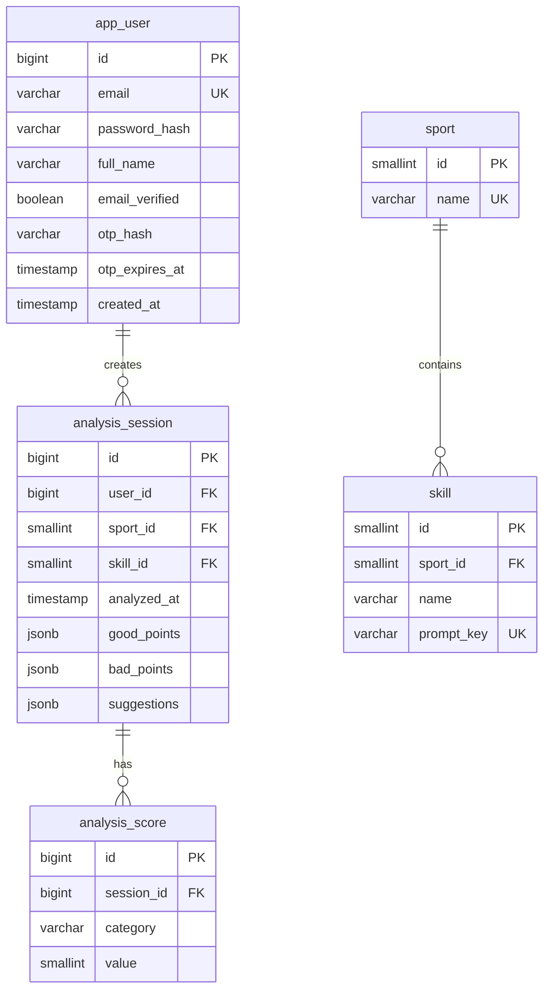
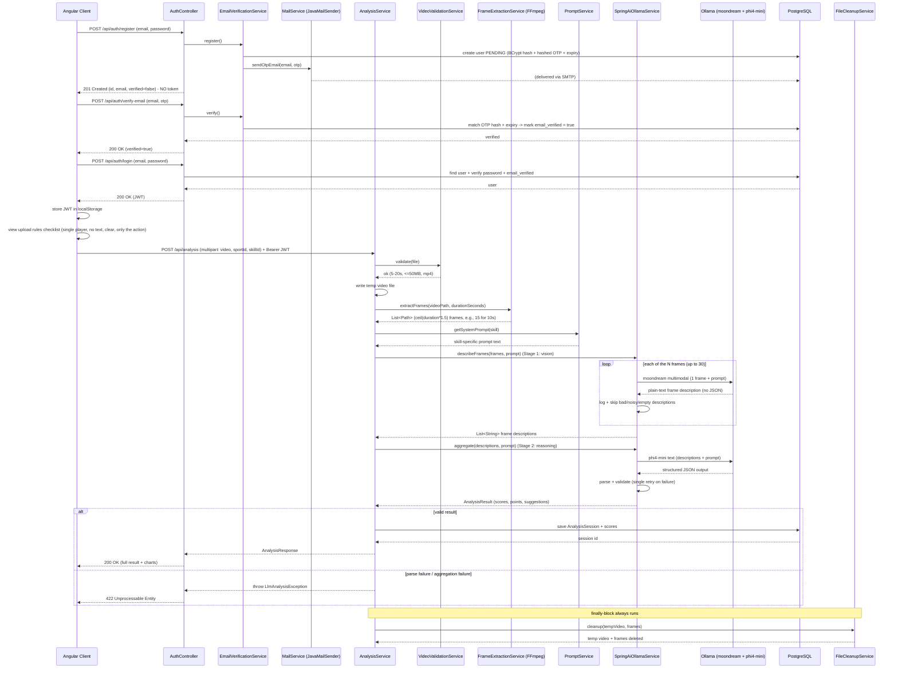

# SportIQ — AI-Based Sports Performance Analysis App

**Low-Level Design (LLD) Document**

| Field | Value |
| --- | --- |
| **Project Name** | SportIQ |
| **Document Version** | 2.0 |
| **Status** | Implementation-Ready (directly usable for coding) |
| **Predecessor** | `hld.md` (v1.1) — this document is fully consistent with it |
| **Scope** | Single actor (Player), fully local/on-premise, no cloud services (SMTP used only for the registration OTP) |

---

## Table of Contents

1. [Database Schema (Detailed)](#1-database-schema-detailed)
2. [System Prompt Design](#2-system-prompt-design)
3. [API Design (REST Endpoints)](#3-api-design-rest-endpoints)
4. [Backend Module & Class Design](#4-backend-module--class-design)
5. [End-to-End Sequence Diagram](#5-end-to-end-sequence-diagram)
6. [Frame Extraction Logic](#6-frame-extraction-logic)
7. [Error Handling & Edge Cases](#7-error-handling--edge-cases)
8. [Frontend Module Structure (Angular)](#8-frontend-module-structure-angular)
9. [Security Considerations](#9-security-considerations)
10. [Deployment / Run Notes (Local Only)](#10-deployment--run-notes-local-only)

---

## 1. Database Schema (Detailed)

### 1.1 Overview

PostgreSQL is the single source of truth. Only **text-based analysis results** are persisted. The uploaded video and extracted frames are **never** stored in the database — they exist only in a temporary filesystem directory and are deleted immediately after analysis (both success and failure paths). This matches `hld.md` §6 ("No `Video` entity exists").

Accounts are created in a **pending** state and become usable only after **email (OTP) verification** — the `app_user` table carries the verification flag and the (hashed, expiring) OTP fields used during registration. BMI/calorie calculator inputs and results are **never stored**.

### 1.2 DDL (Executable in PostgreSQL)

```sql
-- =============================================================================
-- SPORTIQ SCHEMA
-- =============================================================================

-- Player actor (single actor; only role in the system)
-- Created PENDING; must verify email via OTP before login is allowed.
CREATE TABLE app_user (
    id             BIGSERIAL      PRIMARY KEY,
    email          VARCHAR(255)   NOT NULL,
    password_hash  VARCHAR(255)   NOT NULL,
    full_name      VARCHAR(255)   NOT NULL,
    email_verified BOOLEAN        NOT NULL DEFAULT FALSE,
    otp_hash       VARCHAR(255),
    otp_expires_at TIMESTAMP,
    created_at     TIMESTAMP      NOT NULL DEFAULT NOW(),
    CONSTRAINT uq_app_user_email UNIQUE (email)
);

-- Sport catalog (Cricket, Football) — seeded at startup
CREATE TABLE sport (
    id   SMALLINT     PRIMARY KEY,
    name VARCHAR(50)  NOT NULL,
    CONSTRAINT uq_sport_name UNIQUE (name)
);

-- Skill catalog; each skill belongs to one sport and maps to a hardcoded prompt
CREATE TABLE skill (
    id          SMALLINT     PRIMARY KEY,
    sport_id    SMALLINT     NOT NULL,
    name        VARCHAR(50)  NOT NULL,
    prompt_key  VARCHAR(100) NOT NULL,
    CONSTRAINT fk_skill_sport     FOREIGN KEY (sport_id) REFERENCES sport(id),
    CONSTRAINT uq_skill_prompt_key UNIQUE (prompt_key),
    CONSTRAINT uq_skill_sport_name UNIQUE (sport_id, name)
);

-- One persisted analysis result (text only; no media)
CREATE TABLE analysis_session (
    id          BIGSERIAL   PRIMARY KEY,
    user_id     BIGINT      NOT NULL,
    sport_id    SMALLINT    NOT NULL,
    skill_id    SMALLINT    NOT NULL,
    analyzed_at TIMESTAMP   NOT NULL DEFAULT NOW(),
    good_points JSONB       NOT NULL,
    bad_points  JSONB       NOT NULL,
    suggestions JSONB       NOT NULL,
    CONSTRAINT fk_session_user  FOREIGN KEY (user_id)  REFERENCES app_user(id) ON DELETE CASCADE,
    CONSTRAINT fk_session_sport FOREIGN KEY (sport_id) REFERENCES sport(id),
    CONSTRAINT fk_session_skill FOREIGN KEY (skill_id) REFERENCES skill(id)
);

-- Flexible key-value child table: one row per scored category per session
CREATE TABLE analysis_score (
    id         BIGSERIAL   PRIMARY KEY,
    session_id BIGINT      NOT NULL,
    category   VARCHAR(50) NOT NULL,
    value      SMALLINT    NOT NULL,
    CONSTRAINT fk_score_session FOREIGN KEY (session_id)
        REFERENCES analysis_session(id) ON DELETE CASCADE,
    CONSTRAINT uq_score_session_category UNIQUE (session_id, category),
    CONSTRAINT ck_score_value_range CHECK (value BETWEEN 0 AND 100)
);

-- =============================================================================
-- INDEXES (query paths from hld.md §4 dashboard / history)
-- =============================================================================
CREATE INDEX idx_session_user        ON analysis_session (user_id);
CREATE INDEX idx_session_user_sport  ON analysis_session (user_id, sport_id);
CREATE INDEX idx_session_user_skill  ON analysis_session (user_id, skill_id);
CREATE INDEX idx_session_analyzed_at ON analysis_session (analyzed_at DESC);
CREATE INDEX idx_score_session        ON analysis_score (session_id);
```

### 1.3 Seed Data (Sport + Skill catalog)

Seeded once at application startup (see `DataSeeder` in §4.6). Values must match the `prompt_key` naming convention `{sport}_{skill}`:

| sport.id | sport.name | skill.id | skill.name | skill.prompt_key |
| --- | --- | --- | --- | --- |
| 1 | Cricket | 1 | Bowling | `cricket_bowling` |
| 1 | Cricket | 2 | Batting | `cricket_batting` |
| 1 | Cricket | 3 | Fielding | `cricket_fielding` |
| 2 | Football | 4 | Power Shot | `football_power_shot` |
| 2 | Football | 5 | Header | `football_header` |
| 2 | Football | 6 | Placed Shot | `football_placed_shot` |
| 2 | Football | 7 | Bicycle Kick | `football_bicycle_kick` |
| 2 | Football | 8 | Goalkeeping | `football_goalkeeping` |

### 1.4 Mermaid ER Diagram



### 1.5 Why `analysis_score` Is a Flexible Key-Value Child Table

The AI model returns **different category keys per skill** (e.g., Cricket-Batting may score `stance`, `footwork`, `shot_timing`; Football-Header may score `jump_timing`, `heading_technique`, `accuracy`). Two options exist:

- **Fixed columns** (`form`, `power`, `accuracy`, …) would either force every skill to share the same categories (losing skill-specific nuance) or force `NULL`-heavy wide tables that need a schema migration every time a category is added.
- **Key-value child table** (`category`, `value`) maps naturally to the LLM's per-skill JSON object, needs **no migrations** when categories vary, and supports trend queries with a simple `GROUP BY category` over a session range.

This is the design used here. The `analysis_session.good_points / bad_points / suggestions` are stored as JSONB arrays because their count and content are variable-length free text from the model.

---

## 2. System Prompt Design

### 2.1 Organization (Hardcoded in the Spring Boot Codebase)

Prompts are **hardcoded** in the backend (per `hld.md` — not DB-driven). The mapping key is `skill.prompt_key` from the database, and each key resolves to a prompt template via a Java enum. The `PromptService` (see §4.6) looks up the `Skill` entity, reads its `promptKey`, and returns the matching `SkillPrompt` template.

```java
package com.sportiq.prompt;

public enum SkillPrompt {

    CRICKET_BOWLING(
        "cricket_bowling",
        """
        You are a cricket bowling coach. Analyze the attached video frames of a bowler's delivery.
        Score each of these categories from 0 to 100: run_up, release, accuracy, speed, follow_through.
        ...
        """
    ),

    CRICKET_BATTING(
        "cricket_batting",
        """
        You are a cricket batting coach. Analyze the attached video frames of a batting shot.
        Score each of these categories from 0 to 100: stance, footwork, shot_timing, shot_selection, power.
        ...
        """
    ),

    CRICKET_FIELDING(
        "cricket_fielding",
        """
        You are a cricket fielding coach. Analyze the attached video frames of a fielding action.
        Score each of these categories from 0 to 100: catching, throwing, agility, field_awareness.
        ...
        """
    ),

    FOOTBALL_POWER_SHOT(
        "football_power_shot",
        """
        You are a football striking coach. Analyze the attached video frames of a power shot.
        Score each of these categories from 0 to 100: run_up, striking_technique, power, accuracy, follow_through.
        ...
        """
    ),

    FOOTBALL_HEADER(
        "football_header",
        """
        You are a football heading coach. Analyze the attached video frames of a header.
        Score each of these categories from 0 to 100: jump_timing, heading_technique, neck_strength, accuracy, positioning.
        ...
        """
    ),

    FOOTBALL_PLACED_SHOT(
        "football_placed_shot",
        """
        You are a football finishing coach. Analyze the attached video frames of a placed shot.
        Score each of these categories from 0 to 100: striking_technique, placement, composure, accuracy, decision_making.
        ...
        """
    ),

    FOOTBALL_BICYCLE_KICK(
        "football_bicycle_kick",
        """
        You are a football acrobatic skills coach. Analyze the attached video frames of a bicycle kick.
        Score each of these categories from 0 to 100: technique, timing, power, accuracy, control.
        ...
        """
    ),

    FOOTBALL_GOALKEEPING(
        "football_goalkeeping",
        """
        You are a football goalkeeping coach. Analyze the attached video frames of a goalkeeper action.
        Score each of these categories from 0 to 100: positioning, reflexes, diving_technique, catching, distribution.
        ...
        """
    );

    private final String promptKey;
    private final String systemPrompt;

    SkillPrompt(String promptKey, String systemPrompt) {
        this.promptKey = promptKey;
        this.systemPrompt = systemPrompt;
    }

    public String getPromptKey() { return promptKey; }
    public String getSystemPrompt() { return systemPrompt; }

    public static SkillPrompt fromKey(String promptKey) {
        for (SkillPrompt p : values()) {
            if (p.promptKey.equals(promptKey)) return p;
        }
        throw new IllegalArgumentException("No prompt defined for key: " + promptKey);
    }
}
```

> **Note:** the prompt text above is abbreviated with `...`; the **full** prompts are shown for two skills in §2.2. Every `SkillPrompt` constant follows the exact same structure (persona → task → frame instructions → scoring categories → strict-JSON contract).

### 2.2 Full Example System Prompts

#### Example 1 — Cricket Batting (`cricket_batting`)

```text
You are an expert cricket batting coach. You will receive video frames
(N frames, roughly 1.5 per second) extracted from a player's batting shot
(5-20 seconds of footage).

Analyze the frames carefully, paying attention to: stance, grip, backlift,
footwork, head position, timing, shot selection, and follow-through.

You MUST respond with STRICT JSON only. No prose, no markdown, no code fences.
The JSON must match exactly this structure:

{
  "scores": { "stance": 0, "footwork": 0, "shot_timing": 0, "shot_selection": 0, "power": 0 },
  "good_points": ["...", "..."],
  "bad_points": ["...", "..."],
  "improvements": ["...", "..."]
}

Rules:
- Every score is an integer between 0 and 100 (no decimals).
- Include the exact keys listed under "scores" - do not add or remove any.
- good_points: 2-4 short, specific phrases of what the player did well.
- bad_points: 2-4 short, specific phrases of what went wrong.
- improvements: 2-4 short, actionable coaching instructions.
- All text values must be plain strings without special characters.
```

#### Example 2 — Football Header (`football_header`)

```text
You are an expert football heading coach. You will receive video frames
(N frames, roughly 1.5 per second) extracted from a player performing a header
(5-20 seconds of footage).

Analyze the frames carefully, paying attention to: jump timing, body shape
(arched back), neck/head contact point, eyes on the ball, accuracy of the
headed ball, and landing/positioning.

You MUST respond with STRICT JSON only. No prose, no markdown, no code fences.
The JSON must match exactly this structure:

{
  "scores": { "jump_timing": 0, "heading_technique": 0, "neck_strength": 0, "accuracy": 0, "positioning": 0 },
  "good_points": ["...", "..."],
  "bad_points": ["...", "..."],
  "improvements": ["...", "..."]
}

Rules:
- Every score is an integer between 0 and 100 (no decimals).
- Include the exact keys listed under "scores" - do not add or remove any.
- good_points: 2-4 short, specific phrases of what the player did well.
- bad_points: 2-4 short, specific phrases of what went wrong.
- improvements: 2-4 short, actionable coaching instructions.
- All text values must be plain strings without special characters.
```

### 2.3 Variable Category Keys per Skill

The `scores` object uses **skill-specific keys**, as summarized below. The backend never hardcodes a fixed score schema globally — instead it parses `scores` as a `Map<String, Integer>` and persists each entry as an `analysis_score` row (§1.2).

| prompt_key | score categories |
| --- | --- |
| `cricket_bowling` | run_up, release, accuracy, speed, follow_through |
| `cricket_batting` | stance, footwork, shot_timing, shot_selection, power |
| `cricket_fielding` | catching, throwing, agility, field_awareness |
| `football_power_shot` | run_up, striking_technique, power, accuracy, follow_through |
| `football_header` | jump_timing, heading_technique, neck_strength, accuracy, positioning |
| `football_placed_shot` | striking_technique, placement, composure, accuracy, decision_making |
| `football_bicycle_kick` | technique, timing, power, accuracy, control |
| `football_goalkeeping` | positioning, reflexes, diving_technique, catching, distribution |

### 2.4 Safe Parsing / Validation (Spring AI + fallback)

The structured-output handling applies to the **Stage 2 aggregation call (phi4-mini)** only — see §2.5. The backend uses a **structured output converter** as the primary path and a **manual Jackson fallback** with a single retry, per `hld.md` §3.4 and §7.3.

1. **Primary — Spring AI structured output.** Call `.entity(AnalysisResult.class)` on the `reasoningChatClient` (see §4.6 `SpringAiOllamaService`). Spring AI maps phi4-mini's JSON into the typed DTO via the configured converter.
2. **Validation.** `AnalysisValidator` checks: `scores` is a non-empty `Map<String,Integer>` with every value in `[0,100]`; `goodPoints/badPoints/improvements` are non-null lists.
3. **Retry.** If parsing/validation fails, the aggregation request is **retried once** (a fresh phi4-mini call). If the second attempt also fails, the analysis is aborted with a **controlled error** (`422 Unprocessable Entity`), and cleanup still runs.

```java
public record AnalysisResult(
    Map<String, Integer> scores,
    List<String> goodPoints,
    List<String> badPoints,
    List<String> improvements
) {}
```

> **Note on phi4-mini:** as a small local text LLM, it may still occasionally emit text outside the JSON schema. The manual Jackson fallback strips surrounding prose (e.g., finds the first `{` … last `}` substring) before parsing, then applies the same validation. This two-path design keeps the round trip within budget and avoids hard failures.

### 2.5 Two-Stage AI Pipeline (Vision model → Reasoning model)

The AI work is explicitly split across two local models on the same Ollama server — a **vision stage** that produces free-text descriptions and a **reasoning stage** that aggregates them into the structured result. This separation exists because `moondream`, as a small local VLM, is unreliable for strict structured output, so it is only asked for plain text; the JSON contract is delegated to `phi4-mini`, a small text LLM that is far better suited to following the schema.

1. **Stage 1 — Vision (`moondream`).** Loop over the extracted frames (order preserved, `ceil(duration × 1.5)` frames). For each frame, make **one** `moondream` call with a single image + the skill-specific prompt, and capture the returned **plain-text description** of that frame. No structured output is requested or parsed at this stage. Call failures, or descriptions that are obviously empty/garbled, are **logged and skipped** — a few imperfect descriptions must not crash the loop or abort the analysis.
2. **Stage 2 — Aggregation (`phi4-mini`).** Collect all frame descriptions and make **one** `phi4-mini` call that includes those descriptions plus the sport/skill context, requesting the strict JSON `AnalysisResult` (scores, `goodPoints`, `badPoints`, `improvements`). The Safe Parsing / Validation logic from §2.4 (Path A `.entity(...)`, Path B manual Jackson with a single retry) runs against **this** call.
3. **Failure semantics.** A single bad frame is tolerable (skip + log). The aggregation call itself failing or timing out (after the single retry) is a distinct, controlled failure → `422` with `FileCleanupService` still invoked.

---

## 3. API Design (REST Endpoints)

### 3.1 Security Rules

- `POST /api/auth/register`, `POST /api/auth/verify-email`, and `POST /api/auth/resend-otp` are **public**.
- **Every other endpoint** requires the header `Authorization: Bearer <JWT>`.
- Spring Security stateless JWT filter validates the token on every protected request (design in §4.5).
- **Login requires a verified email.** An unverified account receives `403` with a "verify your email first" message.

### 3.2 Endpoint Table

| # | Method | Path | Auth | Purpose |
| --- | --- | --- | --- | --- |
| 1 | POST | `/api/auth/register` | Public | Create **pending** account, email OTP (NO token) |
| 2 | POST | `/api/auth/verify-email` | Public | Activate account by confirming the emailed OTP |
| 3 | POST | `/api/auth/resend-otp` | Public | Re-email a fresh OTP for a pending account |
| 4 | POST | `/api/auth/login` | Public | Authenticate (verified accounts only), return JWT |
| 5 | GET | `/api/users/me` | Bearer | Current profile |
| 6 | PUT | `/api/users/me` | Bearer | Update profile |
| 7 | GET | `/api/sports` | Bearer | List sports |
| 8 | GET | `/api/sports/{sportId}/skills` | Bearer | Skills for a sport |
| 9 | POST | `/api/analysis` | Bearer | Upload video + run full analysis (synchronous) |
| 10 | GET | `/api/analysis/history?sportId=&skillId=&page=&size=` | Bearer | Paginated history |
| 11 | GET | `/api/analysis/history/{sessionId}` | Bearer | Single session detail |

### 3.3 Detailed Endpoint Specifications

#### 1. Register — `POST /api/auth/register`

**Request body**
```json
{
  "email": "player@example.com",
  "password": "secret123",
  "fullName": "Aarav Sharma"
}
```
**Behaviour:** creates the account in **PENDING** state (`email_verified = false`), hashes the password, generates a 6-digit OTP, stores `otp_hash` + `otp_expires_at` (10 min), and emails the code via `JavaMailSender`.
**Response — `201 Created`** (NO token; the account is not usable until verified)
```json
{
  "id": 42,
  "email": "player@example.com",
  "fullName": "Aarav Sharma",
  "verified": false
}
```
**Status codes:** `201` pending account created + OTP emailed · `409` email already exists · `400` validation failure (weak password / bad email / blank name).

#### 2. Verify Email — `POST /api/auth/verify-email`

**Request body**
```json
{
  "email": "player@example.com",
  "otp": "482913"
}
```
**Behaviour:** looks up the pending account, checks the OTP has not expired, hashes the submitted code and compares it to `otp_hash`. On match: sets `email_verified = true`, clears `otp_hash`/`otp_expires_at`, returns success. No token is issued — the user logs in separately.
**Response — `200 OK`**
```json
{ "id": 42, "email": "player@example.com", "verified": true }
```
**Status codes:** `200` verified · `400` invalid/expired OTP or email · `409` email already verified.

#### 3. Resend OTP — `POST /api/auth/resend-otp`

**Request body**
```json
{ "email": "player@example.com" }
```
**Behaviour:** for an existing **pending** account, generates a new OTP, refreshes `otp_expires_at`, and re-emails it. Idempotent per email; rate-limited (e.g., max 3 resends in 10 minutes) to avoid mail spam.
**Response — `200 OK`**
```json
{ "message": "A new verification code was sent to player@example.com" }
```
**Status codes:** `200` sent · `404` no pending account for that email · `409` email already verified · `429` too many resend attempts.

#### 4. Login — `POST /api/auth/login`

**Request body**
```json
{
  "email": "player@example.com",
  "password": "secret123"
}
```
**Behaviour:** verifies credentials **and** `email_verified = true` before issuing a token. Unverified accounts are rejected so dummy/never-confirmed emails cannot authenticate.
**Response — `200 OK`**
```json
{
  "token": "<JWT>",
  "tokenType": "Bearer",
  "expiresInSeconds": 86400,
  "user": { "id": 42, "email": "player@example.com", "fullName": "Aarav Sharma", "verified": true }
}
```
**Status codes:** `200` success · `401` invalid credentials · `403` email not verified · `400` malformed body.

#### 5. Current Profile — `GET /api/users/me`

**Headers:** `Authorization: Bearer <JWT>`
**Response — `200 OK`**
```json
{
  "id": 42,
  "email": "player@example.com",
  "fullName": "Aarav Sharma",
  "createdAt": "2026-07-01T10:00:00Z"
}
```
**Status codes:** `200` · `401` missing/expired token.

#### 6. Update Profile — `PUT /api/users/me`

**Request body** (only `fullName` is editable; email is immutable to keep identity stable)
```json
{ "fullName": "Aarav S." }
```
**Response — `200 OK`** (updated `UserResponse`). **Status codes:** `200` · `400` blank name · `401` unauthorised.

#### 7. List Sports — `GET /api/sports`

**Response — `200 OK`**
```json
[
  { "id": 1, "name": "Cricket" },
  { "id": 2, "name": "Football" }
]
```

#### 8. List Skills for a Sport — `GET /api/sports/{sportId}/skills`

**Response — `200 OK`**
```json
[
  { "id": 1, "name": "Bowling", "promptKey": "cricket_bowling" },
  { "id": 2, "name": "Batting", "promptKey": "cricket_batting" },
  { "id": 3, "name": "Fielding", "promptKey": "cricket_fielding" }
]
```
**Status codes:** `200` · `404` unknown sportId.

#### 9. Run Analysis — `POST /api/analysis` (synchronous)

**Request:** `multipart/form-data`
- `file` — video file (`mp4`), 5–20 s, ≤ 50 MB
- `sportId` — form field (e.g., `1`)
- `skillId` — form field (e.g., `2`)

**Upload rules checklist (UI guidance only):** before upload the frontend displays — single player only, no on-screen text/watermarks, clear stable footage, and only the sport action itself. The backend does **not** model-check these; only the technical limits above are enforced.

**Processing pipeline (must complete within the 10-minute budget):** validate → extract frames at 1.5 fps → prompt → vision stage (moondream, per-frame) → reasoning stage (phi4-mini) → parse/validate → persist → cleanup → respond.

**Response — `200 OK`**
```json
{
  "sessionId": 512,
  "sport": "Cricket",
  "skill": "Batting",
  "analyzedAt": "2026-07-07T12:30:00Z",
  "scores": { "stance": 80, "footwork": 70, "shot_timing": 88, "shot_selection": 76, "power": 82 },
  "goodPoints": ["Balanced base at the crease", "Head still on impact"],
  "badPoints": ["Back foot slightly late", "Front elbow dropped"],
  "improvements": ["Push off the back foot earlier", "Keep the front elbow high through the line"]
}
```
**Status codes:**
- `200` success (result shown to player)
- `400` invalid multipart (missing file/sportId/skillId, wrong file type)
- `422` video violates duration (not 5–20 s) or size (> 50 MB)
- `422` reasoning (phi4-mini) output could not be parsed after the single retry
- `422` phi4-mini aggregation call failed or timed out (cleanup still runs)
- `404` sportId/skillId not found (or skill does not belong to sport)
- `503` Ollama server unreachable / model unavailable
- `504` overall round trip exceeded the 10-minute budget
- `500` frame extraction failure or unexpected internal error

> **Failure guarantee:** on **all** error paths above (after the video is accepted), the temp video and extracted frames are deleted before the error response is returned (see §4.6 `FileCleanupService`).

#### 10. History (paginated) — `GET /api/analysis/history?sportId=&skillId=&page=&size=`

**Query params:** `sportId` (optional), `skillId` (optional), `page` (0-based, default 0), `size` (default 10, max 50).

**Response — `200 OK`**
```json
{
  "content": [
    {
      "sessionId": 512,
      "sport": "Cricket",
      "skill": "Batting",
      "analyzedAt": "2026-07-07T12:30:00Z",
      "averageScore": 79.2,
      "scores": { "stance": 80, "footwork": 70, "shot_timing": 88, "shot_selection": 76, "power": 82 }
    }
  ],
  "page": 0,
  "size": 10,
  "totalElements": 23,
  "totalPages": 3,
  "trends": {
    "stance": [80, 82, 85],
    "power": [82, 80, 86]
  }
}
```
**Notes:**
- `trends` is computed by `HistoryService` as the ordered `value` series per category across the returned sessions (filtered by sport/skill), supporting the dashboard score-trend charts (`hld.md` §3.6). Trends are rendered as **line/area charts** (Chart.js) in the dashboard.
- `averageScore` = arithmetic mean of all category values for that session.

#### 11. Session Detail — `GET /api/analysis/history/{sessionId}`

**Response — `200 OK`**
```json
{
  "sessionId": 512,
  "sport": "Cricket",
  "skill": "Batting",
  "analyzedAt": "2026-07-07T12:30:00Z",
  "scores": { "stance": 80, "footwork": 70, "shot_timing": 88, "shot_selection": 76, "power": 82 },
  "goodPoints": ["Balanced base at the crease", "Head still on impact"],
  "badPoints": ["Back foot slightly late", "Front elbow dropped"],
  "improvements": ["Push off the back foot earlier", "Keep the front elbow high through the line"]
}
```
**Status codes:** `200` · `404` session not found or belongs to another user (sessions are owned by the authenticated user).

---

## 4. Backend Module & Class Design

### 4.1 Package Structure

```
com.sportiq
├── SportIqApplication.java              # @SpringBootApplication
├── config/
│   ├── SecurityConfig.java              # filter chain, CORS, password encoder bean
│   ├── AiConfig.java                    # visionChatClient (moondream) + reasoningChatClient (phi4-mini) beans
│   └── DataSeeder.java                  # seeds sport + skill rows (idempotent)
├── security/
│   ├── JwtService.java                  # generate / parse / validate tokens
│   ├── JwtAuthenticationFilter.java     # OncePerRequestFilter
│   ├── JwtAuthenticationEntryPoint.java # 401 JSON responses
│   └── UserPrincipal.java               # wraps authenticated user id
├── controller/
│   ├── AuthController.java
│   ├── UserController.java
│   ├── SportController.java
│   └── AnalysisController.java
├── service/
│   ├── AuthService.java
│   ├── OtpService.java                  # OTP generate / hash / verify / expiry
│   ├── MailService.java                 # JavaMailSender wrapper (sends OTP emails)
│   ├── EmailVerificationService.java    # register(pending) / verify / resend orchestration
│   ├── SportSkillService.java
│   ├── VideoValidationService.java
│   ├── FrameExtractionService.java
│   ├── PromptService.java
│   ├── SpringAiOllamaService.java
│   ├── AnalysisService.java
│   ├── HistoryService.java
│   └── FileCleanupService.java
├── repository/
│   ├── AppUserRepository.java
│   ├── SportRepository.java
│   ├── SkillRepository.java
│   ├── AnalysisSessionRepository.java
│   └── AnalysisScoreRepository.java
├── entity/
│   ├── AppUser.java
│   ├── Sport.java
│   ├── Skill.java
│   ├── AnalysisSession.java
│   └── AnalysisScore.java
├── prompt/
│   └── SkillPrompt.java                 # enum (§2.1)
├── dto/
│   ├── request/
│   │   ├── RegisterRequest.java
│   │   ├── VerifyEmailRequest.java
│   │   ├── ResendOtpRequest.java
│   │   ├── LoginRequest.java
│   │   └── UpdateProfileRequest.java
│   ├── response/
│   │   ├── RegisterResponse.java
│   │   ├── VerifyEmailResponse.java
│   │   ├── ResendOtpResponse.java
│   │   ├── LoginResponse.java
│   │   ├── UserResponse.java
│   │   ├── SportResponse.java
│   │   ├── SkillResponse.java
│   │   ├── AnalysisResponse.java
│   │   ├── HistoryPageResponse.java
│   │   └── SessionDetailResponse.java
│   └── ai/
│       ├── AnalysisResult.java          # record (§2.4)
│       └── AnalysisValidator.java
├── exception/
│   ├── ApiError.java                    # {timestamp, status, message, path}
│   ├── GlobalExceptionHandler.java      # @RestControllerAdvice
│   ├── DuplicateEmailException.java
│   ├── InvalidCredentialsException.java
│   ├── EmailNotVerifiedException.java
│   ├── OtpException.java                # wrong / expired / already-verified OTP
│   ├── MailSendException.java           # SMTP failure wrapper
│   ├── VideoValidationException.java
│   ├── FrameExtractionException.java
│   ├── LlmAnalysisException.java
│   └── ResourceNotFoundException.java
└── util/
    └── SecurityUtils.java               # current authenticated user id
```

### 4.2 Controllers

**AuthController**
```java
@RestController
@RequestMapping("/api/auth")
public class AuthController {
    private final AuthService authService;
    private final EmailVerificationService emailVerificationService;

    @PostMapping("/register")
    @ResponseStatus(HttpStatus.CREATED)
    public RegisterResponse register(@Valid @RequestBody RegisterRequest req) { ... }

    @PostMapping("/verify-email")
    public VerifyEmailResponse verifyEmail(@Valid @RequestBody VerifyEmailRequest req) { ... }

    @PostMapping("/resend-otp")
    public ResendOtpResponse resendOtp(@Valid @RequestBody ResendOtpRequest req) { ... }

    @PostMapping("/login")
    public LoginResponse login(@Valid @RequestBody LoginRequest req) { ... }
}
```

**UserController**
```java
@RestController
@RequestMapping("/api/users")
public class UserController {
    @GetMapping("/me") public UserResponse me() { ... }
    @PutMapping("/me") public UserResponse update(@Valid @RequestBody UpdateProfileRequest req) { ... }
}
```

**SportController**
```java
@RestController
@RequestMapping("/api/sports")
public class SportController {
    @GetMapping public List<SportResponse> listSports() { ... }
    @GetMapping("/{sportId}/skills") public List<SkillResponse> listSkills(@PathVariable int sportId) { ... }
}
```

**AnalysisController**
```java
@RestController
@RequestMapping("/api/analysis")
public class AnalysisController {
    @PostMapping(consumes = MediaType.MULTIPART_FORM_DATA_VALUE)
    public AnalysisResponse analyze(@RequestParam("file") MultipartFile file,
                                    @RequestParam("sportId") int sportId,
                                    @RequestParam("skillId") int skillId) { ... }

    @GetMapping("/history") public HistoryPageResponse history(
        @RequestParam(required = false) Integer sportId,
        @RequestParam(required = false) Integer skillId,
        @RequestParam(defaultValue = "0") int page,
        @RequestParam(defaultValue = "10") int size) { ... }

    @GetMapping("/history/{sessionId}") public SessionDetailResponse sessionDetail(
        @PathVariable long sessionId) { ... }
}
```

### 4.3 Entities (JPA)

**AppUser**
```java
@Entity @Table(name = "app_user")
public class AppUser {
    @Id @GeneratedValue(strategy = GenerationType.IDENTITY) private Long id;
    @Column(nullable = false, unique = true) private String email;
    @Column(name = "password_hash", nullable = false) private String passwordHash;
    @Column(name = "full_name", nullable = false) private String fullName;
    @Column(name = "email_verified", nullable = false)
    private boolean emailVerified = false;
    @Column(name = "otp_hash") private String otpHash;
    @Column(name = "otp_expires_at") private Instant otpExpiresAt;
    @Column(name = "created_at", nullable = false, updatable = false)
    @CreationTimestamp private Instant createdAt;
    // getters/setters omitted for brevity
}
```

**Sport**
```java
@Entity @Table(name = "sport")
public class Sport {
    // id is assigned EXPLICITLY by the DataSeeder (small fixed catalog; no auto-generation).
    // Column is SMALLINT PK per the DDL in §1.2. Use Integer (matching SMALLINT) here.
    @Id @Column(nullable = false) private Integer id;
    @Column(nullable = false, unique = true) private String name;

    public Sport() {}
    public Sport(Integer id, String name) { this.id = id; this.name = name; }
}
```

**Skill**
```java
@Entity @Table(name = "skill")
public class Skill {
    // id is assigned EXPLICITLY by the DataSeeder (small fixed catalog; no auto-generation).
    // Column is SMALLINT PK per the DDL in §1.2. Use Integer (matching SMALLINT) here.
    @Id @Column(nullable = false) private Integer id;
    @ManyToOne(fetch = FetchType.EAGER, optional = false)
    @JoinColumn(name = "sport_id") private Sport sport;
    @Column(nullable = false) private String name;
    @Column(name = "prompt_key", nullable = false, unique = true) private String promptKey;

    public Skill() {}
    public Skill(Integer id, Sport sport, String name, String promptKey) {
        this.id = id; this.sport = sport; this.name = name; this.promptKey = promptKey;
    }
}
```

**AnalysisSession**
```java
@Entity @Table(name = "analysis_session")
public class AnalysisSession {
    @Id @GeneratedValue(strategy = GenerationType.IDENTITY) private Long id;
    @ManyToOne(fetch = FetchType.LAZY, optional = false)
    @JoinColumn(name = "user_id") private AppUser user;
    @ManyToOne(fetch = FetchType.EAGER, optional = false)
    @JoinColumn(name = "sport_id") private Sport sport;
    @ManyToOne(fetch = FetchType.EAGER, optional = false)
    @JoinColumn(name = "skill_id") private Skill skill;
    @Column(name = "analyzed_at", nullable = false)
    @CreationTimestamp private Instant analyzedAt;

    @Column(name = "good_points", columnDefinition = "jsonb", nullable = false)
    private List<String> goodPoints;
    @Column(name = "bad_points", columnDefinition = "jsonb", nullable = false)
    private List<String> badPoints;
    @Column(name = "suggestions", columnDefinition = "jsonb", nullable = false)
    private List<String> improvements;

    @OneToMany(mappedBy = "session", cascade = CascadeType.ALL, orphanRemoval = true)
    private List<AnalysisScore> scores = new ArrayList<>();

    public void addScore(String category, int value) {
        scores.add(new AnalysisScore(this, category, value));
    }
}
```

**AnalysisScore**
```java
@Entity @Table(name = "analysis_score",
        uniqueConstraints = @UniqueConstraint(columnNames = {"session_id", "category"}))
public class AnalysisScore {
    @Id @GeneratedValue(strategy = GenerationType.IDENTITY) private Long id;
    @ManyToOne(fetch = FetchType.LAZY, optional = false)
    @JoinColumn(name = "session_id") private AnalysisSession session;
    @Column(nullable = false) private String category;
    @Column(nullable = false) private Integer value;
    // constructors, getters/setters
}
```

> **Tip:** for the `jsonb` `List<String>` columns, register a small Jackson-based attribute converter, or use `@JdbcTypeCode(SqlTypes.JSON)` with Hibernate 6, so the lists serialize/deserialize cleanly.

### 4.4 Repositories (Spring Data JPA)

```java
public interface AppUserRepository extends JpaRepository<AppUser, Long> {
    Optional<AppUser> findByEmail(String email);
    boolean existsByEmail(String email);
}

public interface SportRepository extends JpaRepository<Sport, Integer> {}

public interface SkillRepository extends JpaRepository<Skill, Integer> {
    List<Skill> findBySportId(Integer sportId);
    Optional<Skill> findByIdAndSportId(Integer id, Integer sportId);
}

public interface AnalysisSessionRepository extends JpaRepository<AnalysisSession, Long> {
    Page<AnalysisSession> findByUserIdAndSportIdAndSkillIdOrderByAnalyzedAtDesc(
            Long userId, Integer sportId, Integer skillId, Pageable pageable);
    Page<AnalysisSession> findByUserIdAndSportIdOrderByAnalyzedAtDesc(
            Long userId, Integer sportId, Pageable pageable);
    Page<AnalysisSession> findByUserIdAndSkillIdOrderByAnalyzedAtDesc(
            Long userId, Integer skillId, Pageable pageable);
    Page<AnalysisSession> findByUserIdOrderByAnalyzedAtDesc(Long userId, Pageable pageable);
    Optional<AnalysisSession> findByIdAndUserId(Long id, Long userId);
}

public interface AnalysisScoreRepository extends JpaRepository<AnalysisScore, Long> {
    List<AnalysisScore> findBySessionIdOrderByIdAsc(Long sessionId);
    @Query("SELECT sc.category FROM AnalysisScore sc WHERE sc.session.id = :sessionId")
    List<String> findCategoriesBySessionId(Long sessionId);
}
```

> Repository methods are invoked through filter-aware service overloads; only the required ones are kept (dynamic filtering is handled by conditionally calling the correct derived query).

### 4.5 Security Design (Spring Security + JWT)

**JwtService**
```java
@Service
public class JwtService {
    // Secret injected via application.yml: sportiq.jwt.secret (>= 32 chars), sportiq.jwt.expiration-ms
    private final SecretKey key;
    private final long expirationMs;

    public String generateToken(Long userId, String email) {
        return Jwts.builder()
                .setSubject(email)
                .claim("uid", userId)
                .setIssuedAt(new Date())
                .setExpiration(new Date(System.currentTimeMillis() + expirationMs))
                .signWith(key)
                .compact();
    }

    public Claims parse(String token) { return Jwts.parserBuilder().setSigningKey(key).build().parseClaimsJws(token).getBody(); }
    public boolean isValid(String token) { try { parse(token); return true; } catch (JwtException | IllegalArgumentException e) { return false; } }
}
```

**JwtAuthenticationFilter** (`OncePerRequestFilter`)
```java
@Component
public class JwtAuthenticationFilter extends OncePerRequestFilter {
    private final JwtService jwtService;
    private final AppUserRepository userRepository;

    @Override
    protected void doFilterInternal(HttpServletRequest request, HttpServletResponse response,
                                    FilterChain filterChain) throws ServletException, IOException {
        String header = request.getHeader("Authorization");
        if (header != null && header.startsWith("Bearer ")) {
            String token = header.substring(7);
            if (jwtService.isValid(token)) {
                Claims claims = jwtService.parse(token);
                Long uid = claims.get("uid", Long.class);
                request.setAttribute("userId", uid);      // read later via SecurityUtils
            }
        }
        filterChain.doFilter(request, response);
    }
}
```
> **Simplification for scope:** the filter extracts `uid` and exposes it through `SecurityUtils.currentUserId()`. If you prefer full Spring Security integration, set an `Authentication` in `SecurityContextHolder` with a `UserPrincipal` authority; the `@RestControllerAdvice` handles `AccessDenied`/`Authentication` exceptions. The rest of the API reads the authenticated user via `SecurityUtils`.

**SecurityConfig**
```java
@Configuration
@EnableWebSecurity
public class SecurityConfig {
    @Bean public BCryptPasswordEncoder passwordEncoder() { return new BCryptPasswordEncoder(); }

    @Bean
    public SecurityFilterChain filterChain(HttpSecurity http) throws Exception {
        http.csrf(AbstractHttpConfigurer::disable)
            .cors(Customizer.withDefaults())
            .sessionManagement(s -> s.sessionCreationPolicy(SessionCreationPolicy.STATELESS))
            .authorizeHttpRequests(auth -> auth
                .requestMatchers(
                    "/api/auth/register",
                    "/api/auth/verify-email",
                    "/api/auth/resend-otp",
                    "/api/auth/login").permitAll()
                .requestMatchers("/error").permitAll()
                .anyRequest().authenticated())
            .exceptionHandling(e -> e.authenticationEntryPoint(jwtAuthenticationEntryPoint))
            .addFilterBefore(jwtAuthenticationFilter, UsernamePasswordAuthenticationFilter.class);
        return http.build();
    }
}
```
- `CORS`: allowed origins limited to the Angular dev server (e.g., `http://localhost:4200`) — this is a local-only convenience, not a cloud service.

### 4.6 Core Services (Responsibilities + Key Methods)

**DataSeeder** (runs once at startup; idempotent)
```java
@Component
@Order(1)
public class DataSeeder {
    // sport.id and skill.id are manually-assigned explicit values, NOT auto-generated.
    // Intentional: they form a small, fixed static catalog, so IDs are inserted
    // explicitly to match the seed table in LLD §1.3 exactly.
    @Transactional
    public void seedSportCatalog() {
        Sport cricket  = sportRepository.findById(1).orElseGet(() -> {
            Sport s = new Sport(1, "Cricket");
            return sportRepository.save(s);          // explicit id
        });
        // ... Football id=2 similarly

        List<Skill> skills = List.of(
            new Skill(1, cricket, "Bowling",   "cricket_bowling"),
            new Skill(2, cricket, "Batting",   "cricket_batting"),
            new Skill(3, cricket, "Fielding",  "cricket_fielding"),
            new Skill(4, football, "Power Shot",   "football_power_shot"),
            new Skill(5, football, "Header",       "football_header"),
            new Skill(6, football, "Placed Shot",  "football_placed_shot"),
            new Skill(7, football, "Bicycle Kick", "football_bicycle_kick"),
            new Skill(8, football, "Goalkeeping",  "football_goalkeeping")
        );
        // For each skill: save only if not already present by prompt_key
        // (guard: skillRepository.existsByPromptKey(pk) -> skip).
    }
}
```
> **Note on seeding entities:** the `Sport`/`Skill` entities are constructed *with* an explicit `id` because the seeding layer assigns identifiers manually (their `@Id` is a plain `SMALLINT`, no `@GeneratedValue`). This is distinct from `AppUser`, `AnalysisSession`, and `AnalysisScore`, which use `BIGSERIAL` auto-generated IDs. The distinction is by design: the sport/skill catalog is a fixed app-defined reference set, whereas users and analysis rows are dynamic runtime data that must never collide and are therefore handed out auto-generated values.

**AuthService**
```java
@Service
public class AuthService {
    public RegisterResponse register(RegisterRequest req) {
        // 1. if userRepository.existsByEmail(email) -> throw DuplicateEmailException
        // 2. passwordHash = passwordEncoder.encode(req.password())
        // 3. save AppUser with emailVerified = false (pending)
        // 4. otpService.issueOtp(user) -> MailService.sendOtpEmail(user.email, otp)
        // 5. return RegisterResponse(id, email, fullName, verified=false)  // NO token
    }

    public VerifyEmailResponse verifyEmail(VerifyEmailRequest req) {
        // 1. find user by email; if absent -> ResourceNotFoundException
        // 2. if user.emailVerified -> throw OtpException("already verified")
        // 3. if otpService.isExpired(user) || !otpService.matches(req.otp(), user)
        //       -> throw OtpException("invalid or expired OTP")
        // 4. user.setEmailVerified(true); user.clearOtp(); save
        // 5. return VerifyEmailResponse(id, email, verified=true)
    }

    public ResendOtpResponse resendOtp(ResendOtpRequest req) {
        // 1. find user by email (pending only) -> else 404 / 409
        // 2. rate-limit check (max 3 resends / 10 min) -> else 429
        // 3. otpService.issueOtp(user); MailService.sendOtpEmail(...)
        // 4. return ResendOtpResponse("A new verification code was sent to ...")
    }

    public LoginResponse login(LoginRequest req) {
        // 1. find user by email; if absent or !matches(password) -> throw InvalidCredentialsException
        // 2. if !user.isEmailVerified() -> throw EmailNotVerifiedException   // 403
        // 3. token = jwtService.generateToken(user.id, user.email)
        // 4. return LoginResponse(token, "Bearer", expirationMs/1000, user)
    }
}
```

**OtpService**
```java
@Service
public class OtpService {
    // 6-digit numeric code; stored as BCrypt hash (never plaintext);
    // expiry from sportiq.otp.expiry-minutes (default 10 min); single-use.
    public String issueOtp(AppUser user) {
        // 1. String code = String.format("%06d", secureRandom.nextInt(1_000_000))
        // 2. user.setOtpHash(passwordEncoder.encode(code));
        //    user.setOtpExpiresAt(Instant.now().plus(expiryMinutes, MINUTES));
        // 3. return code (plaintext returned to the caller only so MailService can email it)
    }

    public boolean isExpired(AppUser user) {
        return user.getOtpExpiresAt() == null || user.getOtpExpiresAt().isBefore(Instant.now());
    }

    public boolean matches(String code, AppUser user) {
        return user.getOtpHash() != null && passwordEncoder.matches(code, user.getOtpHash());
    }
}
```

**MailService**
```java
@Service
public class MailService {
    private final JavaMailSender mailSender;   // from spring-boot-starter-mail

    public void sendOtpEmail(String to, String otp) {
        // 1. build a SimpleMailMessage:
        //    from sportiq.mail.from-address, to, subject "SportIQ - Your verification code",
        //    body = "Your SportIQ verification code is " + otp + ". It expires in 10 minutes."
        // 2. mailSender.send(message)
        // 3. on MailSendException -> log + throw MailSendException("Could not send verification email")
    }
}
```

**EmailVerificationService** (thin orchestrator, optionally folded into AuthService)
```java
@Service
public class EmailVerificationService {
    // register()  -> creates pending user, issues OTP, emails it
    // verify()    -> validates OTP, activates the account
    // resend()    -> re-issues + re-emails a fresh OTP for a pending account (rate-limited)
}
```

**SportSkillService**
```java
@Service
public class SportSkillService {
    public List<SportResponse> listSports() { return sportRepository.findAll()...; }
    public List<SkillResponse> listSkills(int sportId) {
        Sport sport = sportRepository.findById(sportId).orElseThrow(() -> new ResourceNotFoundException("Sport", sportId));
        return skillRepository.findBySportId(sportId)...;
    }
    public Skill requireSkill(int sportId, int skillId) {
        // validates the skill belongs to the given sport -> else ResourceNotFoundException
        return skillRepository.findByIdAndSportId(skillId, sportId)
            .orElseThrow(() -> new ResourceNotFoundException("Skill", skillId));
    }
}
```

**VideoValidationService**
```java
@Service
public class VideoValidationService {
    public static final long MAX_SIZE_BYTES = 50L * 1024 * 1024; // 50 MB
    public static final int MIN_DURATION_SECONDS = 5;
    public static final int MAX_DURATION_SECONDS = 20;

    public void validate(MultipartFile file) {
        // 1. file null/empty -> VideoValidationException("No video file provided")
        // 2. content type != "video/mp4" (and extension .mp4) -> VideoValidationException("Only MP4 videos are allowed")
        // 3. file.getSize() > MAX_SIZE_BYTES -> VideoValidationException("Video exceeds 50 MB limit")
        // 4. probe duration via ffprobe; if <5 or ->20 seconds -> VideoValidationException("Video must be 5-20 seconds")
    }

    public double probeDurationInSeconds(Path videoPath) {
        // runs: ffprobe -v error -show_entries format=duration -of default=noprint_wrappers=1:nokey=1 <file>
        // parses stdout as double; throws FrameExtractionException on failure
    }
}
```

**FrameExtractionService**
```java
@Service
public class FrameExtractionService {
    // Frames = ceil(durationSeconds * 1.5). Examples: 5 s -> 8, 10 s -> 15,
    // 20 s -> 30. More frames = more vision data = more accurate analysis.
    public static int frameCountFor(double durationSeconds) {
        return (int) Math.ceil(durationSeconds * 1.5);
    }

    public List<Path> extractFrames(Path videoPath, double durationSeconds) {
        // 1. workDir = Files.createTempDirectory("sportiq-" + sessionToken)
        // 2. frameCount = frameCountFor(durationSeconds)
        // 3. intervalSeconds = durationSeconds / frameCount
        // 4. for i in 1..frameCount:
        //      t = round(interval * i, 2)
        //      ffmpeg -ss <t> -i <video> -frames:v 1 -q:v 2 <workDir>/frame_<i>.jpg
        // 5. return sorted list of frame Paths (workDir + all frames)
    }
}
```

**PromptService**
```java
@Service
public class PromptService {
    public String getSystemPrompt(Skill skill) {
        return SkillPrompt.fromKey(skill.getPromptKey()).getSystemPrompt();
    }
}
```

**SpringAiOllamaService** (two-stage pipeline)
```java
@Service
public class SpringAiOllamaService {
    private static final Logger log = LoggerFactory.getLogger(SpringAiOllamaService.class);

    private final ChatClient visionChatClient;    // moondream  (Stage 1: plain-text per-frame descriptions)
    private final ChatClient reasoningChatClient; // phi4-mini  (Stage 2: structured aggregation)

    public SpringAiOllamaService(
            @Qualifier("visionChatClient") ChatClient visionChatClient,
            @Qualifier("reasoningChatClient") ChatClient reasoningChatClient) {
        this.visionChatClient = visionChatClient;
        this.reasoningChatClient = reasoningChatClient;
    }

    // STAGE 1 - VISION (moondream): ONE call per frame, single image + prompt, plain text only.
    // Frames count = ceil(duration × 1.5) (e.g., 15 for a 10 s clip, 30 for a 20 s clip).
    // A bad/noisy or empty description is logged and skipped; the loop never aborts.
    // The whole run is bounded by sportiq.ai.budget-ms (10 min default, handles 30 frames).
    public List<String> describeFrames(List<Path> framePaths, String systemPrompt) {
        List<String> descriptions = new ArrayList<>();
        for (Path frame : framePaths) {
            try {
                UserMessage userMessage = UserMessage.builder()
                        .text(systemPrompt)
                        .media(Media.builder()
                                .data(new MimeType("image", "jpeg"), readBytes(frame))
                                .build())
                        .build();
                String desc = visionChatClient.prompt()
                        .messages(List.of(userMessage))
                        .call()
                        .content()
                        .trim();
                if (!desc.isBlank()) descriptions.add(desc);
                else log.warn("Empty moondream description for {}", frame);
            } catch (Exception e) {
                log.warn("moondream call failed for {} - skipping frame ({})", frame, e.getMessage());
            }
        }
        return descriptions;   // resilient: a few imperfect frames are tolerated
    }

    // STAGE 2 - AGGREGATION (phi4-mini): ONE call with all descriptions + sport/skill context,
    // requesting the structured AnalysisResult. Safe Parsing / Validation (§2.4) applies HERE.
    public AnalysisResult aggregate(List<String> frameDescriptions, String systemPrompt) {
        String body = "Frame descriptions:\n" + String.join("\n---\n", frameDescriptions)
                + "\n\n" + systemPrompt;

        // PATH A - Spring AI structured output:
        try {
            AnalysisResult result = reasoningChatClient.prompt()
                    .system(systemPrompt)
                    .user(body)
                    .call()
                    .entity(AnalysisResult.class);
            if (AnalysisValidator.isValid(result)) return result;
        } catch (Exception ignored) { /* fall through to retry path */ }

        // PATH B - single retry via raw content + manual Jackson parse:
        try {
            String raw = reasoningChatClient.prompt()
                    .system(systemPrompt)
                    .user(body)
                    .call()
                    .content();
            return parseWithJackson(raw);
        } catch (Exception e) {
            throw new LlmAnalysisException("Reasoning (phi4-mini) output could not be parsed after retry", e);
        }
    }
}
```

> **Spring AI configuration (`application.yml`):**
> ```yaml
> spring:
>   ai:
>     ollama:
>       base-url: http://localhost:11434
>       options:
>         temperature: 0.2
>   mail:                                      # placeholders — fill with real SMTP credentials
>     host: smtp.gmail.com
>     port: 587
>     username: YOUR_SMTP_USERNAME             # e.g., demo@gmail.com
>     password: YOUR_SMTP_APP_PASSWORD         # Gmail app password
>     properties:
>       mail:
>         smtp:
>           auth: true
>           starttls:
>             enable: true
>
> sportiq:
>   ai:
>     vision-model: moondream
>     reasoning-model: phi4-mini
>     budget-ms: 600000                        # 10-minute total round-trip budget (handles 30 frames)
>   otp:
>     length: 6
>     expiry-minutes: 10
>     max-resends-per-email: 3
>   mail:
>     from-address: sportiq@example.com
> ```
> `AiConfig` exposes two `ChatClient` beans built from the auto-configured `ChatClient.Builder` (from `spring-ai-ollama-spring-boot-starter`), each pinned to its own model via `OllamaOptions.builder().model(...)`: `visionChatClient` (from `sportiq.ai.vision-model`) and `reasoningChatClient` (from `sportiq.ai.reasoning-model`). Services inject them with `@Qualifier` (see `SpringAiOllamaService`). **No raw HTTP client code is written** for Ollama — all communication goes through Spring AI (`ChatClient`/`ChatModel`, `UserMessage`, `Media`, structured-output converter), per the finalized scope.

**AiConfig** (two `ChatClient` beans, one per model)
```java
@Configuration
public class AiConfig {

    @Bean
    public ChatClient visionChatClient(ChatClient.Builder builder,
            @Value("${sportiq.ai.vision-model}") String visionModel) {
        return builder
                .defaultOptions(OllamaOptions.builder().model(visionModel).build())
                .build();
    }

    @Bean
    public ChatClient reasoningChatClient(ChatClient.Builder builder,
            @Value("${sportiq.ai.reasoning-model}") String reasoningModel) {
        return builder
                .defaultOptions(OllamaOptions.builder().model(reasoningModel).build())
                .build();
    }
}
```

**AnalysisService** (orchestrator)
```java
@Service
public class AnalysisService {
    public AnalysisResponse analyze(Long userId, MultipartFile file, int sportId, int skillId) {
        String sessionToken = UUID.randomUUID().toString();
        Path tempVideo = null;
        List<Path> frames = List.of();
        try {
            // 1. validate video (size/type/duration)
            videoValidationService.validate(file);

            // 2. persist video to temp dir
            tempVideo = Files.createTempFile("sportiq-" + sessionToken, ".mp4");
            file.transferTo(tempVideo);

            // 3. extract frames (FFmpeg) at 1.5 fps -> ceil(duration * 1.5) frames
            frames = frameExtractionService.extractFrames(tempVideo, video.durationSeconds());

            // 4. sport/skill + prompt
            Skill skill = sportSkillService.requireSkill(sportId, skillId);
            String systemPrompt = promptService.getSystemPrompt(skill);

            // 5. two-stage AI via Spring AI (moondream vision -> phi4-mini reasoning)
            List<String> frameDescriptions = springAiOllamaService.describeFrames(frames, systemPrompt);
            AnalysisResult aiResult = springAiOllamaService.aggregate(frameDescriptions, systemPrompt);

            // 6. persist (user, sport, skill, scores, points, suggestions)
            AnalysisSession session = analysisSessionRepository.save(buildSession(userId, sport, skill, aiResult));

            // 7. return result DTO
            return mapToResponse(session);
        } finally {
            // 8. ALWAYS delete temp video + frames (success and failure)
            fileCleanupService.cleanup(tempVideo, frames);
        }
    }
}
```

**HistoryService**
```java
@Service
public class HistoryService {
    public HistoryPageResponse history(Long userId, Integer sportId, Integer skillId, int page, int size) {
        // 1. choose the correct derived query based on which filters are present
        // 2. for each session: collect scores via analysisScoreRepository, compute averageScore
        // 3. build ordered per-category trend series
        // 4. return HistoryPageResponse
    }

    public SessionDetailResponse sessionDetail(Long userId, long sessionId) {
        AnalysisSession s = analysisSessionRepository.findByIdAndUserId(sessionId, userId)
            .orElseThrow(() -> new ResourceNotFoundException("AnalysisSession", sessionId));
        return mapToDetail(s);
    }
}
```

**FileCleanupService**
```java
@Service
public class FileCleanupService {
    public void cleanup(Path videoFile, List<Path> frames) {
        // delete every frame file and its parent temp dir (walk the temp dir)
        // then delete the temp video; swallow IOException per file (log it)
        // Guaranteed invocation from AnalysisService finally-block
    }
}
```

### 4.7 Request/Response DTOs (summary)

| DTO | Fields | Used in |
| --- | --- | --- |
| `RegisterRequest` | `email`, `password`, `fullName` | POST /api/auth/register |
| `VerifyEmailRequest` | `email`, `otp` | POST /api/auth/verify-email |
| `ResendOtpRequest` | `email` | POST /api/auth/resend-otp |
| `LoginRequest` | `email`, `password` | POST /api/auth/login |
| `UpdateProfileRequest` | `fullName` | PUT /api/users/me |
| `RegisterResponse` | `id`, `email`, `fullName`, `verified: false` | register (201, no token, pending) |
| `VerifyEmailResponse` | `id`, `email`, `verified: true` | verify-email |
| `ResendOtpResponse` | `message` | resend-otp |
| `LoginResponse` | `token`, `tokenType`, `expiresInSeconds`, `user: UserResponse` | login |
| `UserResponse` | `id`, `email`, `fullName`, `createdAt` (optionally `verified`) | /users/me |
| `SportResponse` | `id`, `name` | /sports |
| `SkillResponse` | `id`, `name`, `promptKey` | /sports/{id}/skills |
| `AnalysisResponse` | `sessionId`, `sport`, `skill`, `analyzedAt`, `scores: Map<String,Integer>`, `goodPoints`, `badPoints`, `improvements` | POST /api/analysis |
| `HistoryPageResponse` | `content: List<SessionSummary>`, `page`, `size`, `totalElements`, `totalPages`, `trends: Map<String, List<Integer>>` | history |
| `SessionDetailResponse` | `sessionId`, `sport`, `skill`, `analyzedAt`, `scores`, `goodPoints`, `badPoints`, `improvements` | session detail |
| `AnalysisResult` (internal AI DTO) | `scores: Map<String,Integer>`, `goodPoints`, `badPoints`, `improvements` | AI parsing layer |

---

## 5. End-to-End Sequence Diagram



> **Failure-path note:** if Ollama is unreachable, or the phi4-mini aggregation call fails/times out, `SpringAiOllamaService` throws (e.g., wrapped in `LlmAnalysisException` → `503` for connectivity, `422` for the aggregation failure), and the `finally` block in `AnalysisService` still invokes `FileCleanupService`, deleting the temp video and all frames before the error is returned to the client. A single bad/noisy moondream frame description never triggers this path — it is logged and skipped in the Stage 1 loop.

---

## 6. Frame Extraction Logic

### 6.1 Tools

FFmpeg (primary) with its `ffprobe` companion, invoked via `ProcessBuilder` from `FrameExtractionService`. OpenCV is the documented alternative; FFmpeg is chosen because it is CLI-friendly, deterministic, and already assumed installed (`hld.md` §7.1).

### 6.2 Algorithm (fixed-interval, dynamic count — 1.5 frames per second)

```text
FRAMES_PER_SECOND = 1.5
duration  = ffprobe_duration(videoPath)             // seconds, double
FRAME_COUNT = ceil(duration * FRAMES_PER_SECOND)    // 5 s -> 8, 10 s -> 15, 20 s -> 30
interval  = duration / FRAME_COUNT                  // seconds between frames
workDir   = <java.io.tmpdir>/sportiq-<sessionToken>

for i = 1 to FRAME_COUNT:
    t = round(interval * i, 2)                      // evenly spaced across the clip
    ffmpeg -ss <t> -i <videoPath> -frames:v 1 -q:v 2 <workDir>/frame_<i>.jpg
```

Equivalent single-pass filter form (deterministic across FFmpeg builds):

```text
ffmpeg -i <videoPath> -vf "fps=<FRAME_COUNT>/<duration>" -frames:v <FRAME_COUNT> \
       -q:v 2 <workDir>/frame_%01d.jpg
```

**Why dynamic count:** more frames = more data for the vision model = more accurate analysis. A longer clip captures a fuller movement, so the frame count grows with duration (10 s → 15, 20 s → 30) instead of staying fixed.

**Example** for a 10 s video (FRAME_COUNT = 15):
```
ffmpeg -ss 0.67 -i input.mp4 -frames:v 1 -q:v 2 tmp/sportiq-abc123/frame_1.jpg
ffmpeg -ss 1.33 -i input.mp4 -frames:v 1 -q:v 2 tmp/sportiq-abc123/frame_2.jpg
...
ffmpeg -ss 10.00 -i input.mp4 -frames:v 1 -q:v 2 tmp/sportiq-abc123/frame_15.jpg
```

> **Timeout-budget note:** the round-trip budget is **10 minutes** (`sportiq.ai.budget-ms: 600000`, `hld.md` §7.2) — a *total end-to-end* guarantee, not a per-operation ceiling. The per-operation timeouts (FFmpeg `waitFor` 10 s, per-frame moondream calls ~8–10 s each, phi4-mini aggregation ~10 s) are **guards against hangs**, not expected durations — frame extraction is near-instant on a local machine, so in practice the FFmpeg step consumes well under a second and the budget is dominated by the up-to-30 vision calls plus one aggregation call. If the overall flow exceeds the budget, `AnalysisService` aborts with a timeout error and the `finally` block still cleans up all temp files (§7.2, row 16).

### 6.3 Temp File Locations & Naming

- Root: `System.getProperty("java.io.tmpdir")` (e.g., `/tmp` on macOS/Linux).
- Per-analysis subfolder: `sportiq-<sessionToken>` where `sessionToken` is a UUID generated in `AnalysisService`.
- Video: `<root>/sportiq-<sessionToken>.mp4`
- Frames: `<root>/sportiq-<sessionToken>/frame_<n>.jpg`

Embedding the session token prevents collisions between **concurrent analyses** for the same user (`hld.md` §7.3).

### 6.4 ProcessBuilder Invocation (no shell injection)

```java
List<String> cmd = List.of(
    "ffmpeg", "-ss", String.format("%.2f", t),
    "-i", videoPath.toString(),
    "-frames:v", "1", "-q:v", "2",
    frameFile.toString()
);
ProcessBuilder pb = new ProcessBuilder(cmd);
Process p = pb.start();
int exit = p.waitFor(10, TimeUnit.SECONDS) ? p.exitValue() : -1; // 10s guard; extraction is near-instant in practice
if (exit != 0) throw new FrameExtractionException("FFmpeg failed with exit code " + exit);
```
> Every value passed via `List.of(...)` is an argument (no shell), so a user-controlled filename cannot inject commands.

### 6.5 Cleanup Logic

- `FileCleanupService.cleanup(videoFile, frames)` is called from `AnalysisService`'s `finally` block — **always**, success or failure.
- Deletes: each frame file, then the per-session temp directory (walking it), then the temp video file.
- `IOException`s are logged and swallowed (never mask the business result).
- A scheduled sweep (`@Scheduled(fixedDelay = 3600000)`) deletes any `sportiq-*` temp artifacts older than 30 minutes as a safety net against crashed JVMs.

---

## 7. Error Handling & Edge Cases

### 7.1 Global Exception Handling

`GlobalExceptionHandler` (`@RestControllerAdvice`) maps exceptions to consistent `ApiError` JSON:

```json
{ "timestamp": "2026-07-07T12:30:00Z", "status": 422, "message": "Video must be 5-20 seconds", "path": "/api/analysis" }
```

| Exception | HTTP Status | Condition |
| --- | --- | --- |
| `MethodArgumentNotValidException` / `BindException` | 400 | Bean-validation failure on request DTO |
| `MissingServletRequestParameterException` / `MultipartException` | 400 | Missing file / sportId / skillId |
| `DuplicateEmailException` | 409 | Email already registered |
| `EmailNotVerifiedException` | 403 | Login attempted before email OTP verification |
| `OtpException` | 400 | Wrong or expired OTP; `409` when the email is already verified |
| `MailSendException` | 503 | SMTP unavailable / credentials wrong — OTP could not be emailed |
| `InvalidCredentialsException` | 401 | Wrong email or password on login |
| `VideoValidationException` | 422 | File not MP4, > 50 MB, or not 5–20 s |
| `FrameExtractionException` | 500 | FFmpeg/ffprobe failed or timed out |
| `LlmAnalysisException` (aggregation parse failure after retry) | 422 | phi4-mini output unparsable after single retry |
| `LlmAnalysisException` (aggregation call failure / timeout) | 422 | phi4-mini call failed or timed out — distinct from a single moondream frame failure; cleanup still runs |
| Ollama connection failure (from Spring AI, wrapped) | 503 | Ollama server unreachable / model not pulled |
| Round-trip timeout (budget exceeded) | 504 | Overall flow exceeded `sportiq.ai.budget-ms` (10 min) |
| `ResourceNotFoundException` | 404 | Unknown sport/skill/session, session of another user, or no pending account for resend-OTP |
| `ExpiredJwtException` / invalid token (filter) | 401 | Missing / malformed / expired `Authorization` header |

> A single bad/noisy moondream frame description is **not** an exception — it is logged and skipped inside the Stage 1 loop (§2.5) so the aggregation step is resilient to a few imperfect frame descriptions.

### 7.2 Edge Case Matrix

| # | Scenario | Handling | API Response |
| --- | --- | --- | --- |
| 1 | Non-MP4 file uploaded | `VideoValidationService` rejects before any processing | 422 |
| 2 | File > 50 MB | Reject before any processing | 422 |
| 3 | Duration < 5 s or > 20 s | `ffprobe` duration check before frame extraction | 422 |
| 4 | `skillId` not belonging to `sportId` | `SportSkillService.requireSkill` | 404 |
| 5 | Ollama down / timeout | Spring AI throws; wrapped as `LlmAnalysisException`; cleanup still runs | 503 |
| 6 | Bad/noisy moondream frame description | Logged + skipped in the Stage 1 loop; aggregation still runs on the remaining descriptions | continues (no error) |
| 7 | Malformed JSON from phi4-mini aggregation | `AnalysisValidator` fails → retry once → controlled fallback | 422 (after retry) |
| 8 | phi4-mini aggregation call fails / times out | Distinct controlled error (not a single-frame failure); `finally` cleans video+frames | 422 |
| 9 | Frame extraction fails | `FrameExtractionException`; finally-block cleans video+frames | 500 |
| 10 | JWT expired / invalid | Filter does not authenticate; entry point returns 401 JSON | 401 |
| 11 | Duplicate email on register | DB unique + `existsByEmail` check | 409 |
| 12 | Concurrent uploads same user | Per-session temp dir (`sportiq-<uuid>`) isolates files; optionally serialize per user via `@Lock`/`synchronized` map or a per-user permit to be safe | normal responses |
| 13 | `file.transferTo` IO failure | Caught → `VideoValidationException`/500; finally cleans | 500 |
| 14 | Session accessed by another user | `findByIdAndUserId` returns empty → 404 (no data leak) | 404 |
| 15 | Empty `good_points`/`bad_points` from model | Stored as empty JSON arrays; still a valid session | 200 |
| 16 | Round-trip exceeds 10-minute budget | All Spring AI/FFmpeg calls use hang-guards (FFmpeg `waitFor` 10 s, per-frame moondream ~8–10 s, phi4-mini ~10 s); if the overall flow exceeds the budget, a timeout error is returned | 504 / 503 |
| 17 | Dummy/fake email on register | Account stays **pending**; login blocked with 403 until the emailed OTP is confirmed — a fake address can never complete registration | 403 on login |
| 18 | Wrong or expired OTP at verify-email | `OtpException`; user can resend via resend-otp (rate-limited) | 400 / 429 |
| 19 | Email already verified, verify-email re-submitted | Reject with a clear message | 409 |
| 20 | SMTP send fails at register/resend | Account recorded (pending) + `MailSendException`; resend available once mail config is fixed | 503 |
| 21 | OTP brute-force attempts | Rate-limit verify + resend per email; OTPs stored as hashes, single-use, 10-min expiry | 400 / 429 |
| 22 | Video violates an advisory rule (multiple players / text / unclear / wrong action) | **Not rejected** — the upload-rules checklist is UI guidance only; the clip is processed normally | 200 |

---

## 8. Frontend Module Structure (Angular)

### 8.1 Folder / Module Layout

```
src/app/
├── core/
│   ├── http/http.service.ts            # central Http wrapper
│   ├── error/error.interceptor.ts      # normalizes ApiError + auth redirects
│   └── guard/auth.guard.ts             # blocks unauthenticated routes
├── auth/
│   ├── register/register.component.ts  # registration form -> OTP step
│   ├── verify-email/verify-email.component.ts # OTP entry + resend
│   ├── login/login.component.ts        # login form page
│   ├── auth.service.ts                 # register(), verifyEmail(), resendOtp(), login(), stores token in localStorage
│   └── auth.interceptor.ts             # attaches Authorization: Bearer <token>
├── profile/
│   ├── profile.component.ts            # view + edit fullName
│   └── user.service.ts
├── sport-selection/
│   ├── sport-select.component.ts       # step 1: pick sport -> loads skills
│   ├── skill-select.component.ts       # step 2: pick skill
│   └── sport.service.ts
├── analysis/
│   ├── upload/upload.component.ts      # file picker + rules checklist + sport/skill + submit
│   ├── result/result.component.ts      # renders AnalysisResponse + score chart
│   └── analysis.service.ts             # postAnalysis(multipart), getHistory, getSession
├── history/
│   ├── dashboard/dashboard.component.ts# filters + trend charts (score trends)
│   └── history.service.ts
├── tools/
│   ├── bmi/bmi.component.ts            # BMI calculator (stateless)
│   ├── calorie/calorie.component.ts    # calorie calculator (stateless)
│   └── tools.service.ts
├── shared/
│   ├── score-chart/score-chart.component.ts  # bar/radar chart for one analysis
│   ├── trend-chart/trend-chart.component.ts  # line chart for history trends
│   └── ...
├── models/
│   ├── user.model.ts
│   ├── sport.model.ts
│   ├── skill.model.ts
│   ├── analysis.model.ts
│   └── history.model.ts
└── app-routing.module.ts
```

> **UI overhaul (guide requirement):** the whole frontend is re-skinned as a **rich, sports-branded platform** — dark athletic theme with accent gradients, hero/landing imagery, sport icons, animated transitions, card-based layouts, and a dedicated rules/OTP/calculator flows that match that look. Chart.js renders score bars/radar on the result page and line/area trends on the dashboard.

### 8.2 Key Services

**AuthService**
```ts
@Injectable({ providedIn: 'root' })
export class AuthService {
  private readonly TOKEN_KEY = 'sportiq_jwt';

  register(req: RegisterRequest): Observable<RegisterResponse> {
    return this.http.post('/api/auth/register', req);   // 201, NO token, account PENDING
  }

  verifyEmail(email: string, otp: string): Observable<VerifyEmailResponse> {
    return this.http.post('/api/auth/verify-email', { email, otp });
  }

  resendOtp(email: string): Observable<ResendOtpResponse> {
    return this.http.post('/api/auth/resend-otp', { email });
  }

  login(req: LoginRequest): Observable<LoginResponse> {
    return this.http.post('/api/auth/login', req).pipe(
      tap(resp => localStorage.setItem(this.TOKEN_KEY, resp.token))  // store JWT in localStorage
    );
  }

  getToken(): string | null { return localStorage.getItem(this.TOKEN_KEY); }
  isAuthenticated(): boolean { return !!this.getToken(); }
  logout(): void { localStorage.removeItem(this.TOKEN_KEY); }
}
```

**AuthInterceptor** (attaches JWT on every protected request)
```ts
@Injectable()
export class AuthInterceptor implements HttpInterceptor {
  intercept(req: HttpRequest<any>, next: HttpHandler) {
    const token = localStorage.getItem('sportiq_jwt');
    if (token) {
      req = req.clone({ setHeaders: { Authorization: `Bearer ${token}` } });
    }
    return next.handle(req);
  }
}
```

**AnalysisService**
```ts
@Injectable({ providedIn: 'root' })
export class AnalysisService {
  analyze(file: File, sportId: number, skillId: number): Observable<AnalysisResponse> {
    const fd = new FormData();
    fd.append('file', file);
    fd.append('sportId', String(sportId));
    fd.append('skillId', String(skillId));
    return this.http.post<AnalysisResponse>('/api/analysis', fd); // synchronous round trip < 10 min
  }

  getHistory(params: { sportId?: number; skillId?: number; page?: number; size?: number }) {
    return this.http.get<HistoryPageResponse>('/api/analysis/history', { params });
  }

  getSession(id: number) {
    return this.http.get<SessionDetailResponse>(`/api/analysis/history/${id}`);
  }
}
```

**HistoryService** wraps dashboard trend queries; **UserService** wraps `/api/users/me`; **ToolsService** exposes pure calculator helpers (`computeBmi`, `computeCalories`) used by the BMI/calorie components.

### 8.3 Upload Rules Checklist (UI guidance)

Before the file picker is enabled, the analyze page shows a rules panel:

| Rule | Why it matters |
| --- | --- |
| Video must be **5–20 seconds** | enforced by the backend (422 if violated) |
| **Single player only** | analysis targets one athlete's action |
| **No on-screen text / watermarks** | text can confuse the vision model |
| **Clear, stable footage** | blurry/pixelated frames degrade accuracy |
| **Only the sport action** (e.g., just the batting shot, not the run-up/warm-up before or after) | keeps the AI focused on the drill |

These are **advisory** — the user can still upload and the clip is processed normally; only the technical limits are enforced by `VideoValidationService`.

### 8.4 BMI & Calorie Calculators (stateless)

- **BMI:** weight (kg) ÷ height(m)² → category label (underweight / normal / overweight / obese) + advisory note.
- **Calories:** age, gender, weight, height, activity level, goal → BMR (Mifflin-St Jeor) → TDEE = BMR × activity factor → daily calorie target for the chosen goal.
- Both run **entirely in the browser** (`ToolsService` pure functions). No inputs or results are sent to or stored by the backend.

### 8.5 Routing & Guard

```ts
// app-routing.module.ts
const routes: Routes = [
  { path: 'register',    component: RegisterComponent },                 // public
  { path: 'verify-email', component: VerifyEmailComponent },             // public
  { path: 'login',       component: LoginComponent },                    // public
  { path: 'sports',      component: SportSelectComponent, canActivate: [AuthGuard] },
  { path: 'skills',      component: SkillSelectComponent, canActivate: [AuthGuard] },
  { path: 'analyze',     component: UploadComponent,    canActivate: [AuthGuard] },
  { path: 'result/:sessionId', component: ResultComponent, canActivate: [AuthGuard] },
  { path: 'dashboard',   component: DashboardComponent, canActivate: [AuthGuard] },
  { path: 'bmi',         component: BmiComponent,       canActivate: [AuthGuard] },
  { path: 'calorie',     component: CalorieComponent,   canActivate: [AuthGuard] },
  { path: 'profile',     component: ProfileComponent,   canActivate: [AuthGuard] },
  { path: '',            redirectTo: 'dashboard', pathMatch: 'full' },
  { path: '**',          redirectTo: 'dashboard' }
];
```

**AuthGuard**
```ts
@Injectable({ providedIn: 'root' })
export class AuthGuard implements CanActivate {
  constructor(private auth: AuthService, private router: Router) {}
  canActivate(): boolean {
    if (this.auth.isAuthenticated()) return true;
    this.router.navigate(['/login']);
    return false;
  }
}
```

### 8.6 Register → Verify → Login → Token Flow (explicit)

1. `RegisterComponent` submits `AuthService.register(...)`.
2. On **201**, the user is navigated to `/verify-email` with their email pre-filled — **no token is issued**.
3. `VerifyEmailComponent` submits `AuthService.verifyEmail(email, otp)`; on success it offers a "Go to login" action.
4. If the OTP expired or never arrived, the user calls `AuthService.resendOtp(email)`.
5. `LoginComponent` submits `AuthService.login(...)` (verified accounts only; unverified → `403`).
6. On **200**, `AuthService` stores the JWT in **localStorage** (tap inside `login()`).
7. The user is redirected to `/sports` (or `/dashboard`).
8. Every subsequent request is intercepted by `AuthInterceptor`, which adds `Authorization: Bearer <token>`; `AuthGuard` protects all routes other than `/register`, `/verify-email`, and `/login`.

---

## 9. Security Considerations

### 9.1 JWT Expiry (no refresh flow — per scope)

- **Single access token**, expiry **24 hours** (configurable via `sportiq.jwt.expiration-ms`), stored in localStorage.
- **No refresh token flow** — the scope explicitly keeps it simple for a local college project. On `401`, the client clears the token and redirects to `/login`.
- Signing secret: `sportiq.jwt.secret` in `application.yml` (≥ 32 random characters). JWT is HS256-signed (e.g., `jjwt` library).

### 9.2 localStorage Trade-off (acknowledged)

Consistent with `hld.md` §3.1: the JWT is stored in **localStorage** because it is the simplest approach. Known trade-off: localStorage is more exposed to XSS than `httpOnly` cookies. This is **accepted** because the app is fully local/offline, non-production, and only ever talks to the local backend and local Ollama.

### 9.3 Password Hashing

- `BCryptPasswordEncoder` (Spring Security), strength 10.
- Only the hash is stored (`app_user.password_hash`); plaintext never persisted or logged.
- Login verifies via `passwordEncoder.matches(raw, hash)`.

### 9.4 OTP Security

- OTPs are **6-digit numeric**, generated with `SecureRandom`, stored **BCrypt-hashed** (`otp_hash`), never plaintext or logged.
- **Single-use** and expire after **10 minutes** (`sportiq.otp.expiry-minutes`).
- `verify-email` and `resend-otp` are **rate-limited** per email (e.g., max 3 resends per 10 minutes, bounded verify attempts) to prevent brute force and mail spam.
- SMTP credentials live only in `application.yml` (`spring.mail.*` placeholders); the from-address is configured via `sportiq.mail.from-address`.

### 9.5 Input Validation on Upload

Enforced **before any processing** (no wasted FFmpeg/AI work):
1. File present and non-empty.
2. MIME `video/mp4` + `.mp4` extension.
3. Size ≤ 50 MB.
4. Duration between 5–20 s (via `ffprobe`).

Also enforced: `@Valid` on all DTOs (email format, password length ≥ 8, non-blank `fullName`, OTP format), and ownership checks on every session query (`findByIdAndUserId`).

---

## 10. Deployment / Run Notes (Local Only)

All components run on the demo machine. **No cloud, no external API, no hosting platform** (except SMTP used only to deliver the registration OTP).

1. **PostgreSQL (local):**
   - Start local PostgreSQL (e.g., `brew services start postgresql@16` or the platform equivalent).
   - Create DB: `createdb sportiq`.
   - Connection in `application.yml`: `jdbc:postgresql://localhost:5432/sportiq`, user `postgres`, password set locally. `spring.jpa.hibernate.ddl-auto=update` (or run the DDL from §1.2 manually for full control).

2. **Ollama (local):**
   - Install Ollama: `brew install ollama`.
   - Pull models: `ollama pull moondream` and `ollama pull phi4-mini`.
   - Run: `ollama serve` (defaults to `http://localhost:11434`).

3. **SMTP for email verification:**
   - Fill the `spring.mail.*` placeholders in `application.yml` with real SMTP credentials (e.g., Gmail address + app password) and set `sportiq.mail.from-address`.
   - A dummy/fake mailbox cannot complete registration because the account stays pending until the OTP is confirmed.

4. **Spring Boot backend:**
   - `application.yml` contains the Spring AI Ollama config pointing at `http://localhost:11434` (§4.6), the DB config, the mail config, and `sportiq.jwt.secret` / `sportiq.jwt.expiration-ms` / `sportiq.ai.budget-ms`.
   - Dependencies in `pom.xml`: `spring-boot-starter-web`, `spring-boot-starter-security`, `spring-boot-starter-data-jpa`, `spring-boot-starter-validation`, `spring-boot-starter-mail`, `postgresql`, `spring-ai-starter-model-ollama`, `jjwt-api/impl/jackson` (JWT), `jackson-databind` (already via web).
   - FFmpeg/ffprobe available on PATH.
   - Run: `mvn spring-boot:run`.

5. **Angular frontend:**
   - `npm install` then `ng serve` (dev server at `http://localhost:4200`).
   - CORS in `SecurityConfig` allows `http://localhost:4200` (local-only).
   - Chart.js (`ng2-charts`) added for score/trend charts.
   - For a single-process demo, the built Angular app can be served from Spring Boot static resources (`mvn package` → `ng build --output-path .../src/main/resources/static`), then run the single JAR.

6. **Optional local Docker (convenience only, not required):**
   - A `docker-compose.yml` for `postgres:16` and `ollama/ollama` on the local host keeps the demo environment tidy. No cloud registry, no orchestration platform. (SMTP mail still runs from the host as above.)

---

*End of LLD — SportIQ*
